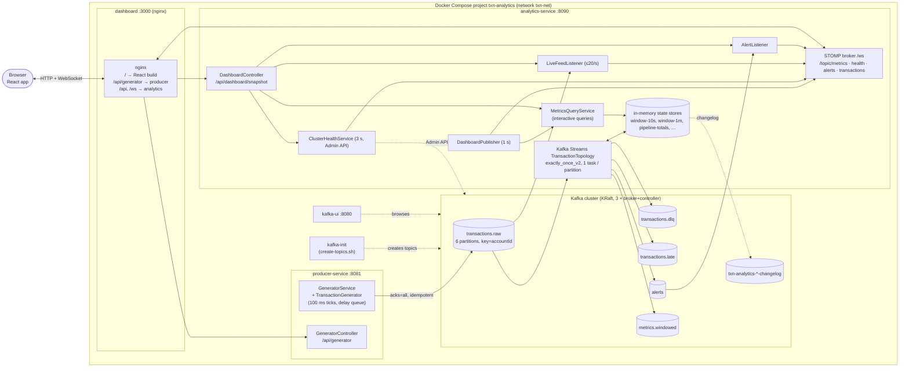

# Banking Transaction Analytics — developer documentation

This folder documents the whole codebase: every folder, file, class and function, how the parts connect, and how to run and test the system. It was written from the source code (Java 21 / Spring Boot 4.1 / Kafka 4.4 / React 19) on branch `main`.

## Index

| Page | Covers |
|---|---|
| **[README.md](README.md)** (this page) | overview, architecture, how to run, test summary |
| [data-flow.md](data-flow.md) | every interface in one place: Kafka topics, keys and payloads, state stores, STOMP destinations, REST endpoints, counter relationships |
| [txn-common.md](txn-common.md) | shared module: `TransactionEvent` and enums, `Topics`, JSON serdes |
| [producer-service.md](producer-service.md) | transaction generator: rate control, injected irregularities, REST control API, Kafka producer settings |
| [analytics-service.md](analytics-service.md) | Kafka Streams topology (parse/DLQ, dedupe, sequence check, lateness, totals, alerts, windows), interactive queries, WebSocket push, cluster health, live feed |
| [dashboard.md](dashboard.md) | React app: STOMP hook and reducer, selectors, formatting, every component, nginx and Vite config |
| [infrastructure.md](infrastructure.md) | `docker-compose.yml`, `.env`, `infra/kafka/create-topics.sh`, Dockerfiles, Maven root pom and wrapper, root files |
| [scripts.md](scripts.md) | system tests against the running stack: smoke, failover, accuracy, load, WebSocket check |
| [observations.md](observations.md) | inconsistencies, stale comments and unused code found while documenting |
| [RUNBOOK.md](RUNBOOK.md) | operations (written before these docs): start/stop, failover demo, generator control, troubleshooting, known limits |

## What the system does

It generates synthetic banking transactions, streams them through a 3-broker Kafka cluster, processes them with **Kafka Streams**, and shows near-real-time metrics on a **React** dashboard updated over **WebSocket (STOMP)**. The processing handles the usual streaming problems: **ordering** (per-account sequence check), **late events** (event-time windows with a grace period), **duplicates** (dedupe by `eventId`), **bad data** (dead-letter queue), **windowed aggregation** (10 s and 1 min tumbling windows), **alerts** (high value and velocity), and **exactly-once** processing. The generator injects each of these irregularities on purpose and counts them, so the dashboard and the test scripts can compare what was injected with what was detected.

## Architecture



### Components at a glance

| Component | Tech | Role |
|---|---|---|
| [`txn-common`](txn-common.md) | Java library, Jackson 3, kafka-clients | event model, topic names, JSON serdes shared by both services |
| [`producer-service`](producer-service.md) | Spring Boot 4.1, Spring Kafka | generates transactions at a configurable rate, injects irregularities, idempotent `acks=all` producer, REST control |
| [`analytics-service`](analytics-service.md) | Spring Boot 4.1, Kafka Streams 4.4, Spring WebSocket/STOMP | streaming analytics, alerts, interactive queries, 1 push/s to browsers, cluster health |
| [`dashboard`](dashboard.md) | React 19, Vite, TypeScript, Recharts, `@stomp/stompjs`, nginx | live UI and generator controls |
| [Kafka](infrastructure.md#docker-composeyml) | `apache/kafka:4.4.0` × 3 (KRaft), `kafbat/kafka-ui` | RF 3, `min.insync.replicas=2`, 3-voter controller quorum |
| [`scripts/`](scripts.md) | bash + python3 + node | system tests on the deployed stack |

### Processing pipeline (analytics-service)

```
transactions.raw (key = accountId, 6 partitions)
  └─ ParseResultSerde + EventTimeExtractor (timestamp = eventTime)
       ├─ invalid ──────────────────────────────► transactions.dlq   (original bytes)
       └─ valid → EnrichedEvent
            → DedupeProcessor        (flags duplicate eventIds; dedupe-store)
            → SequenceCheckProcessor (flags out-of-order / gaps; sequence-store)
            → LatenessClassifier     (ON_TIME / LATE_ACCEPTED / LATE_DROPPED vs 10 s window + 30 s grace)
            → TotalsProcessor        (pipeline-totals, per partition)
                 ├─ unique: amountInr ≥ 100,000 ──────────────► alerts (HIGH_VALUE)
                 ├─ unique: > 10 per account per 1 min window ─► alerts (VELOCITY)
                 ├─ unique: LATE_DROPPED ──────────────────────► transactions.late
                 └─ accepted → WindowAggregateProcessor 10 s / 1 min
                                 ├─ window-10s / window-1m stores ──► MetricsQueryService ──► /topic/metrics (1/s)
                                 └─ changed windows every 1 s ──────► metrics.windowed
```

Details: [analytics-service › TransactionTopology](analytics-service.md#transactiontopologyjava). Every interface: [data-flow.md](data-flow.md).

### Key design decisions (and where they live)

| Concern | Approach | Code |
|---|---|---|
| Ordering | key = `accountId` (one partition per account); idempotent producer; per-account sequence store flags out-of-order events and gaps | `KafkaEventSender`, `application.yml` (producer), `SequenceCheckProcessor` |
| Event time | the record timestamp is `eventTime`, so windows reflect when transactions happened | `EventTimeExtractor` |
| Late events | 30 s grace corrects windows; later events are excluded and sent to `transactions.late` | `LatenessClassifier`, `TransactionTopology` |
| Per-partition stream time | one sub-topology, one task per partition, partial aggregates merged at query time, so replay-speed differences after a restart don't create false late events | `TransactionTopology`, `WindowAggregateProcessor`, `MetricsQueryService`, `WindowAgg.merge` |
| Duplicates | a window store of seen `eventId`s | `DedupeProcessor` |
| Exactly-once | `exactly_once_v2`, changelogs with RF 3, transactions protocol pinned to v1 | `application.yml`, `create-topics.sh` |
| Bad data | a non-throwing input serde; invalid records go to the DLQ with their original bytes and can't advance stream time | `ParseResultSerde`, `EventTimeExtractor` |
| Browser load | the backend reads stores and pushes one message per second, whatever the event rate; the live feed is rate-limited to 20/s | `DashboardPublisher`, `LiveFeedListener`, `RateLimiter` |
| State store performance | in-memory stores with compacted, small-segment changelogs (RocksDB caused stalls under EOS) | `TransactionTopology.CHANGELOG` |
| Resilience | crashed stream threads are replaced; 60 s transaction timeout; 60 s stop grace | `StreamsTopologyConfig`, `application.yml`, `docker-compose.yml` |

## Repository layout

```
Kafka Analytics/
├── README.md                 project overview (root)
├── IMPLEMENTATION_PLAN.md    original design plan
├── docker-compose.yml        full stack                         → infrastructure.md
├── .env                      ports, image, cluster id, generator defaults
├── pom.xml, mvnw, mvnw.cmd, .mvn/   Maven parent + wrapper
├── .gitignore, .dockerignore
├── infra/kafka/create-topics.sh     topic creation (kafka-init)
├── txn-common/               shared model + serdes               → txn-common.md
├── producer-service/         generator service                   → producer-service.md
├── analytics-service/        Kafka Streams + dashboard backend   → analytics-service.md
├── dashboard/                React app + nginx                   → dashboard.md
├── scripts/                  system tests                        → scripts.md
└── docs/                     this documentation + RUNBOOK.md
```

## How to run

### Full stack with Docker Compose

Requirements: Docker with Compose, about 4 GB of free RAM.

```bash
docker compose up -d --build
```

```bash
docker compose ps
```

Startup order is enforced by health checks: `kafka-1/2/3` healthy → `kafka-init` creates the topics and exits 0 → `producer-service`, `analytics-service`, `kafka-ui` → `dashboard`. On a fresh cluster Kafka Streams needs about 30–40 s to create its internal topics, and the header shows `Streams: REBALANCING` until then.

| URL | What |
|---|---|
| http://localhost:3000 | Dashboard |
| http://localhost:8080 | Kafka UI (topics, partitions, consumer groups) |
| http://localhost:8081/api/generator | Generator API (producer-service) |
| http://localhost:8090/api/dashboard/snapshot | Analytics snapshot (analytics-service) |
| `localhost:19092`, `:29092`, `:39092` | Kafka brokers from the host |

Stop and keep data:

```bash
docker compose stop
```

Full reset (removes Kafka and Streams volumes):

```bash
docker compose down -v
```

Ports and generator defaults are set in [`.env`](../.env); see [infrastructure.md](infrastructure.md#env).

### Local development (IDE)

Start only Kafka:

```bash
docker compose up -d kafka-1 kafka-2 kafka-3 kafka-init kafka-ui
```

Then run `ProducerApplication` and `AnalyticsApplication` from the IDE (open the root `pom.xml` as a Maven project). Both default to `localhost:19092,29092,39092`. Then start the dashboard dev server, which proxies `/api` and `/ws`:

```bash
cd dashboard && npm install && npm run dev
```

Open http://localhost:5173.

### Controlling the generator

Use the dashboard's "Event generator" panel, or:

```bash
curl -s -X PUT localhost:8081/api/generator/settings -H 'Content-Type: application/json' -d '{"ratePerSecond":200,"accounts":5000,"lateRatio":0.03,"maxLatenessSeconds":90,"outOfOrderRatio":0.02,"duplicateRatio":0.01,"highValueRatio":0.005,"burstChancePerSecond":0.05,"burstSize":12}'
```

All fields are required, because the body replaces the whole `GeneratorSettings` record. See [producer-service › GeneratorSettings](producer-service.md#generatorsettingsjava) for the limits.

## Tests

| Level | Command | What it covers | Docs |
|---|---|---|---|
| Backend unit + integration | `./mvnw verify` (Testcontainers ITs need Docker) | serde; generator and service; REST validation; **topology via `TopologyTestDriver`** (event-time windows, grace, late drop, dedupe, ordering, alerts, DLQ, metrics topic); KPI and merge maths; `ProducerKafkaIT` (real Kafka: keys, partitions, idempotence); `AnalyticsIT` (Kafka → Streams → STOMP client and REST) | [txn-common](txn-common.md#tests), [producer](producer-service.md#tests), [analytics](analytics-service.md#tests) |
| Frontend | `cd dashboard && npm test` | reducer, selectors, formatting, components (header, health, KPIs, alerts, generator controls) | [dashboard](dashboard.md#tests) |
| System: smoke | `./scripts/smoke-test.sh` | containers healthy, RF 3 / ISR 3 / min ISR 2, leaders spread, quorum, data flowing, WebSocket | [scripts](scripts.md#smoke-testsh) |
| System: failover | `./scripts/failover-test.sh` | leader broker down, controller down, 2 of 3 down (writes refused), no send errors | [scripts](scripts.md#failover-testsh) |
| System: accuracy | `./scripts/accuracy-test.sh` | analytics restart mid-stream; every acked event received exactly once; duplicates detected = injected | [scripts](scripts.md#accuracy-testsh) |
| System: load | `RATE=500 DURATION=600 ./scripts/load-test.sh` | sustained rate, p95 < 2 s, lag stable | [scripts](scripts.md#load-testsh) |

## Glossary

| Term | Meaning here |
|---|---|
| **Event time** | `TransactionEvent.eventTime`: when the transaction happened. Used for windows. |
| **Stream time** | the highest event time a Kafka Streams task has seen. Here it is kept **per input partition**. |
| **Grace** | how long after a window ends it still accepts late events (30 s) |
| **Late accepted / corrected** | arrived after its window ended but within grace; the window was updated (restated) |
| **Late dropped / too late** | arrived after window end + grace; not counted, written to `transactions.late` |
| **Partial** | one partition's aggregate for a window; global values are the merge of all partials |
| **Out of order** | sequence number ≤ the highest already seen for that account |
| **Gap** | sequence number more than one above the highest already seen (something is missing or still in flight) |
| **Injected vs detected** | the generator's ground-truth counters (`GeneratorStats`) vs the stream's totals (`PipelineTotals`) |
