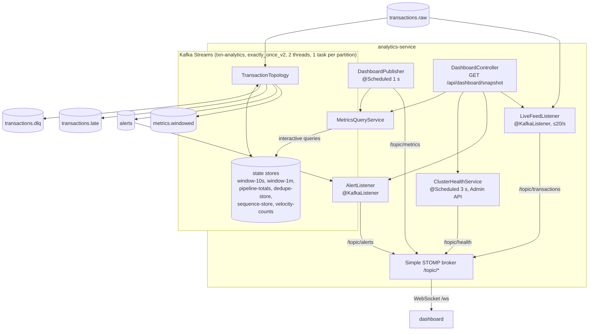
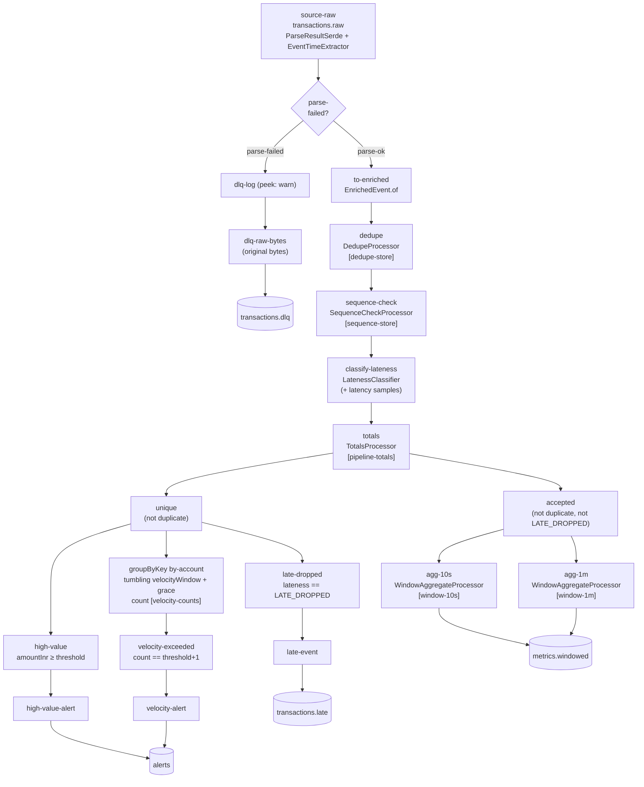

# `analytics-service` — Kafka Streams analytics + dashboard backend

[← Back to docs index](README.md)

A Spring Boot 4.1 application with two jobs:

1. **Stream processing.** It runs the Kafka Streams topology (`TransactionTopology`) that reads `transactions.raw`, validates, de-duplicates, checks ordering, classifies lateness, raises alerts and aggregates tumbling windows into state stores. It writes to `transactions.dlq`, `transactions.late`, `alerts` and `metrics.windowed`.
2. **Dashboard backend.** It reads the state stores with interactive queries and pushes one metrics message per second over STOMP/WebSocket. It also forwards alerts and a sampled live feed from Kafka, polls cluster health with the Admin API, and serves a REST snapshot for freshly opened dashboards.

| | |
|---|---|
| Port | `8090` (`ANALYTICS_PORT`) |
| Main class | `com.bank.txn.analytics.AnalyticsApplication` |
| Streams application id | `txn-analytics` (also the consumer group whose lag is reported) |
| Reads | `transactions.raw` (Streams + `LiveFeedListener`), `alerts` (`AlertListener`) |
| Writes | `transactions.dlq`, `transactions.late`, `alerts`, `metrics.windowed`, plus internal changelog topics `txn-analytics-*-changelog` |
| REST | `GET /api/dashboard/snapshot` |
| WebSocket | STOMP endpoint `/ws`; destinations `/topic/metrics`, `/topic/health`, `/topic/alerts`, `/topic/transactions` |
| Actuator | `/actuator/health` (+ probes), `/actuator/info`, `/actuator/metrics` |
| Depends on | [`txn-common`](txn-common.md) |

## Folder layout

```
analytics-service/
├── Dockerfile
├── pom.xml
└── src/
    ├── main/java/com/bank/txn/analytics/
    │   ├── AnalyticsApplication.java
    │   ├── api/        DashboardController
    │   ├── config/     AnalyticsProperties, StreamsTopologyConfig, WebSocketConfig
    │   ├── dashboard/  DashboardPublisher, DashboardUpdate, KpiCalculator, Kpis, MetricsQueryService, WindowPoint
    │   ├── feed/       AlertListener, LiveFeedListener, RateLimiter, RecentBuffer
    │   ├── health/     ClusterHealth, ClusterHealthService
    │   ├── model/      Alert, Bucket, PipelineTotals, WindowAgg, WindowMetrics
    │   └── stream/     DedupeProcessor, EnrichedEvent, EventTimeExtractor, LatencyTracker, Lateness,
    │                   LatenessClassifier, ParseResult, ParseResultSerde, SequenceCheckProcessor,
    │                   TotalsProcessor, TransactionTopology, WindowAggregateProcessor
    ├── main/resources/application.yml
    └── test/java/com/bank/txn/analytics/
        ├── AnalyticsIT.java
        ├── dashboard/KpiCalculatorTest.java
        ├── feed/RateLimiterTest.java
        ├── model/MergeTest.java
        └── stream/  LatencyTrackerTest, TransactionTopologyTest
```

## Runtime components



---

## Build and container files

### [`pom.xml`](../analytics-service/pom.xml)

- Parent: root `txn-analytics` pom.
- Dependencies: `txn-common`, `spring-boot-starter-webmvc`, `spring-boot-starter-kafka`, `spring-boot-starter-websocket`, `spring-boot-starter-actuator`, `org.apache.kafka:kafka-streams` (4.4.0 via the root `kafka.version`).
- Test: `spring-boot-starter-test`, `spring-boot-starter-webmvc-test`, `kafka-streams-test-utils` (`TopologyTestDriver`), `spring-boot-testcontainers`, `testcontainers-kafka`, `testcontainers-junit-jupiter`.
- Build: `finalName` `analytics-service`, `spring-boot-maven-plugin`, `maven-failsafe-plugin` (runs `AnalyticsIT` in `verify`).

### [`Dockerfile`](../analytics-service/Dockerfile)

Same pattern as producer-service, with the repository root as build context. The JDK 21 build stage runs `./mvnw -pl analytics-service -am package -DskipTests` with a cached `~/.m2`. The JRE 21 runtime stage runs as the non-root `app` user and creates `/var/lib/streams`, owned by `app`. Compose mounts the `streams-state` volume there and points `STREAMS_STATE_DIR` at it. Exposes 8090. The health check sends `GET /actuator/health/readiness` over bash `/dev/tcp` and expects `UP`. Entrypoint: `exec java $JAVA_OPTS -jar /app/app.jar`.

### [`application.yml`](../analytics-service/src/main/resources/application.yml)

**Spring Kafka consumer** (used by the two `@KafkaListener`s, not by Streams):

| Key | Value | Why |
|---|---|---|
| `spring.kafka.bootstrap-servers` | `${KAFKA_BOOTSTRAP:localhost:19092,localhost:29092,localhost:39092}` | |
| `consumer.key-deserializer` | `StringDeserializer` | |
| `consumer.value-deserializer` | Spring `ErrorHandlingDeserializer` with delegate `TransactionEventDeserializer` | A bad record is passed to the container's error handler instead of killing the consumer. `AlertListener` overrides this with `ByteArrayDeserializer`. |
| `consumer.isolation-level` | `read-committed` | only sees records from committed transactions (Streams writes `alerts` transactionally) |

**Kafka Streams**:

| Key | Value | Why |
|---|---|---|
| `streams.application-id` | `txn-analytics` | consumer group, changelog topic prefix, state directory name |
| `streams.replication-factor` | `${STREAMS_REPLICATION_FACTOR:3}` | RF of internal changelog topics |
| `streams.state-dir` | `${STREAMS_STATE_DIR:${java.io.tmpdir}/txn-analytics-state}` | |
| `processing.guarantee` | `exactly_once_v2` | no double counting on failover or restart |
| `commit.interval.ms` | `1000` | fewer transactions; the dashboard reads stores directly, so it doesn't need faster commits |
| `topic.min.insync.replicas` | `${STREAMS_MIN_ISR:2}` | min ISR for internal topics |
| `num.stream.threads` | `2` | 6 input partitions → 6 tasks shared by 2 threads |
| `statestore.cache.max.bytes` | `10485760` (10 MiB) | record cache for the cached stores |
| `windowstore.changelog.additional.retention.ms` | `60000` | the default is 1 day; keeps window changelogs, and so restores, small |
| `producer.transaction.timeout.ms` | `60000` | the EOS default of 10 s aborted transactions during broker hand-offs and forced full state restores |

**`analytics.*`** (bound to [`AnalyticsProperties`](#analyticspropertiesjava), plus two keys read by `@Scheduled`):

| Key | Default | Used by |
|---|---|---|
| `window-size` | `10s` | live windows (`window-10s` store), lateness classification, KPIs |
| `summary-window-size` | `1m` | summary windows (`window-1m` store) |
| `grace` | `30s` | lateness classification, velocity window grace |
| `high-value-threshold-inr` | `100000` | HIGH_VALUE alert (`>=`) |
| `velocity-threshold` | `10` | VELOCITY alert fires when the count reaches threshold + 1 |
| `velocity-window` | `1m` | velocity tumbling window size |
| `dedupe-retention` | `2m` | how long seen `eventId`s are remembered (`Config.defaults()` uses 10 min) |
| `live-feed-max-per-second` | `20` | `LiveFeedListener` rate limit (read with `@Value`) |
| `chart-history` | `5m` | how far back `MetricsQueryService` reads 10 s windows |
| `summary-history` | `30m` | how far back it reads 1 min windows |
| `push-interval-ms` | `1000` | `DashboardPublisher` period (`@Scheduled`) |
| `health-interval-ms` | `3000` | `ClusterHealthService` period (`@Scheduled`) |

**Actuator**: exposes `health,info,metrics`; health probes enabled (`/actuator/health/readiness` for the Docker health check).

---

## Package `com.bank.txn.analytics`

### [`AnalyticsApplication.java`](../analytics-service/src/main/java/com/bank/txn/analytics/AnalyticsApplication.java)

Spring Boot entry point. `@SpringBootApplication`, `@ConfigurationPropertiesScan` (binds `AnalyticsProperties`), `@EnableScheduling` (for `DashboardPublisher` and `ClusterHealthService`). **`main(String[])`** calls `SpringApplication.run`.

---

## Package `config`

### [`AnalyticsProperties.java`](../analytics-service/src/main/java/com/bank/txn/analytics/config/AnalyticsProperties.java)

`@ConfigurationProperties("analytics") public record AnalyticsProperties(Duration windowSize, Duration summaryWindowSize, Duration grace, BigDecimal highValueThresholdInr, long velocityThreshold, Duration velocityWindow, Duration dedupeRetention, int liveFeedMaxPerSecond, Duration chartHistory, Duration summaryHistory)`. Spring binds it from YAML; see the table above.

- **`topologyConfig()`** → `TransactionTopology.Config`: copies the seven topology tunables (window sizes, grace, high-value threshold, velocity threshold and window, dedupe retention) into the topology's own config record, so the topology does not depend on Spring.

### [`StreamsTopologyConfig.java`](../analytics-service/src/main/java/com/bank/txn/analytics/config/StreamsTopologyConfig.java)

`@Configuration @EnableKafkaStreams`. Spring Kafka creates a `StreamsBuilderFactoryBean` from `spring.kafka.streams.*`; this class adds the topology to it.

| Bean | What it does |
|---|---|
| **`latencyTracker()`** | `new LatencyTracker(4096, Clock.systemUTC())`: a ring of the last 4096 latencies. It is shared by `LatenessClassifier` (writes) and `MetricsQueryService` (reads). |
| **`transactionTopology(StreamsBuilder builder, AnalyticsProperties props, LatencyTracker latency)`** | Calls `TransactionTopology.build(builder, props.topologyConfig(), latency)` and returns a dummy `Object`. The bean exists only so the topology is built during context start-up. |
| **`streamsResilience()`** → `StreamsBuilderFactoryBeanConfigurer` | Sets a `StreamsUncaughtExceptionHandler` that logs and returns **`REPLACE_THREAD`**, so a crashed stream thread is restarted instead of shutting the client down. Adds a state listener that logs every `KafkaStreams` state change (`CREATED → REBALANCING → RUNNING …`). |

### [`WebSocketConfig.java`](../analytics-service/src/main/java/com/bank/txn/analytics/config/WebSocketConfig.java)

`@Configuration @EnableWebSocketMessageBroker`, implements `WebSocketMessageBrokerConfigurer`.

| Method | What it does |
|---|---|
| **`registerStompEndpoints(StompEndpointRegistry)`** | Registers the plain-WebSocket STOMP endpoint **`/ws`** (no SockJS) and allows any origin (`setAllowedOriginPatterns("*")`). |
| **`configureMessageBroker(MessageBrokerRegistry)`** | Enables Spring's in-memory **simple broker** for `/topic` with 10 s/10 s heart-beats, matching the dashboard client's `heartbeatIncoming/Outgoing`. Sets the application destination prefix `/app`; no `@MessageMapping` handlers exist, so clients only subscribe. |
| `heartbeatScheduler()` (private) | A one-thread `ThreadPoolTaskScheduler` (`ws-heartbeat-*`) that the simple broker needs for heart-beats. |

---

## Package `api`

### [`DashboardController.java`](../analytics-service/src/main/java/com/bank/txn/analytics/api/DashboardController.java)

`@RestController @RequestMapping("/api/dashboard")`. Gives a freshly opened dashboard its initial state; WebSocket keeps it live afterwards.

- **`record Snapshot(DashboardUpdate metrics, ClusterHealth health, List<Alert> alerts, List<TransactionEvent> transactions)`**: the response body. It matches the dashboard's `Snapshot` type.
- **Constructor**: injects `MetricsQueryService`, `ClusterHealthService`, `AlertListener`, `LiveFeedListener`.
- **`snapshot()`**, `GET /api/dashboard/snapshot`: `new Snapshot(metrics.current(), health.latest(), alerts.recent(), feed.recent())`. Metrics are computed fresh. Health is the last polled value. Alerts (up to 100) and transactions (up to 50) come from the in-memory `RecentBuffer`s, newest first.

The system test scripts use this endpoint heavily (see [scripts](scripts.md)).

---

## Package `dashboard` (metrics read side)

### [`MetricsQueryService.java`](../analytics-service/src/main/java/com/bank/txn/analytics/dashboard/MetricsQueryService.java)

`@Service`. Reads current aggregates **straight from the Kafka Streams state stores** (interactive queries) and builds a `DashboardUpdate`.

| Member | Description |
|---|---|
| **constructor** `(StreamsBuilderFactoryBean, AnalyticsProperties, LatencyTracker)` | uses `Clock.systemUTC()` |
| **`current()`** → `DashboardUpdate` | Gets the `KafkaStreams` instance. `streamsState` is `"NOT_STARTED"` if there is none, otherwise the state name. Only when the state is `RUNNING` does it: read the 10 s windows from `window-10s` for `[now − chartHistory, now]`; read the 1 min windows from `window-1m` for `[now − summaryHistory, now]`; iterate the `pipeline-totals` key-value store (one `"ALL"` entry **per partition**) and `merge` them into one `PipelineTotals`. An `InvalidStateStoreException` (stores migrating during a rebalance) is logged at debug and the state is reported as `"REBALANCING"`. Then it computes `KpiCalculator.compute(windows, windowMs, now)` and returns `DashboardUpdate(now, state, windowMs, graceMs, kpis, windows, summary, totals, latency.snapshot())`. |
| `windows(KafkaStreams, String store, long sizeMs, long from, long now)` (private static) | Runs `fetchAll(from − size, now)` on the `ReadOnlyWindowStore<String, WindowAgg>`. Each partition (task) has its own `"ALL"` entry per window start, so partials with the same start are merged with `WindowAgg::merge` into a `TreeMap` sorted by start. Emits `WindowPoint(start, start+size, complete = start+size ≤ now, agg)`. |

Interactive queries only see **local** tasks. With one instance (as deployed) that is every partition. More instances would need cross-instance queries; [RUNBOOK](RUNBOOK.md) notes this.

### [`DashboardPublisher.java`](../analytics-service/src/main/java/com/bank/txn/analytics/dashboard/DashboardPublisher.java)

`@Component`. **`publish()`**, `@Scheduled(fixedRateString = "${analytics.push-interval-ms:1000}")`: sends `metrics.current()` to **`/topic/metrics`** with `SimpMessagingTemplate.convertAndSend`. Pushing on a fixed tick keeps browser load the same at any event rate.

### [`DashboardUpdate.java`](../analytics-service/src/main/java/com/bank/txn/analytics/dashboard/DashboardUpdate.java)

`public record DashboardUpdate(long generatedAt, String streamsState, long windowMs, long graceMs, Kpis kpis, List<WindowPoint> windows, List<WindowPoint> summaryWindows, PipelineTotals totals, LatencyTracker.Stats latency)`: the `/topic/metrics` payload and the `metrics` part of the snapshot. `generatedAt` (epoch ms) lets the client discard out-of-order pushes. The dashboard does not use `summaryWindows` yet.

### [`Kpis.java`](../analytics-service/src/main/java/com/bank/txn/analytics/dashboard/Kpis.java)

`public record Kpis(double tps, BigDecimal volumeLastMin, long countLastMin, BigDecimal avgTicket, double approvalRate, double peakTps)`: headline numbers. **`EMPTY`** is all zeros.

### [`KpiCalculator.java`](../analytics-service/src/main/java/com/bank/txn/analytics/dashboard/KpiCalculator.java)

`public final class KpiCalculator`: pure functions, no state.

- **`static Kpis compute(List<WindowPoint> windows, long windowMs, long nowMs)`**:
  1. Keeps only *complete* windows (`end ≤ now`), sorted by start. If there are none, returns `Kpis.EMPTY`.
  2. `tps = latest.count / windowSeconds` (the latest complete window).
  3. For windows with `start ≥ latest.end − 60 s` (the last 6 × 10 s windows): sums `count`, `approved` and approved `volume`.
  4. `peakTps` = the highest window count in the history ÷ window seconds.
  5. `avgTicket = volume / approved` (scale 2, HALF_UP; 0 if nothing approved). `approvalRate = approved / count`.
  6. `tps` and `peakTps` are rounded to 1 decimal (`round1`).
- `round1(double)` (private): `Math.round(v×10)/10.0`.

### [`WindowPoint.java`](../analytics-service/src/main/java/com/bank/txn/analytics/dashboard/WindowPoint.java)

`public record WindowPoint(long start, long end, boolean complete, WindowAgg agg)`: one merged window for the charts. `complete` means the window's end has passed. A complete window can still change during the grace period.

---

## Package `feed` (Kafka → browser forwarding)

### [`LiveFeedListener.java`](../analytics-service/src/main/java/com/bank/txn/analytics/feed/LiveFeedListener.java)

`@Component`. Samples the raw stream for the "Live transactions" table.

- **Constructor** `(SimpMessagingTemplate ws, @Value("${analytics.live-feed-max-per-second:20}") int maxPerSecond)`: builds a `RateLimiter(maxPerSecond, System::nanoTime)` and a `RecentBuffer<TransactionEvent>(50)`.
- **`onEvent(TransactionEvent event)`**: `@KafkaListener(id = "live-feed", topics = transactions.raw, groupId = "dashboard-feed-${HOSTNAME:local}", properties = auto.offset.reset=latest)`. If the event is non-null and the limiter allows it, adds it to the buffer and sends it to **`/topic/transactions`**. Everything else is skipped, so most events are not forwarded. Each instance has its own group (keyed by host name) and starts from the latest offset, so every instance sees the whole stream.
- **`recent()`**: a snapshot of the buffer, newest first (for the REST snapshot).

### [`AlertListener.java`](../analytics-service/src/main/java/com/bank/txn/analytics/feed/AlertListener.java)

`@Component`, implements `ConsumerSeekAware`. Forwards alerts to the dashboard.

- `DESERIALIZER`: a static `JsonDeserializer<Alert>`. `recent`: `RecentBuffer<Alert>(100)`.
- **`onAlert(ConsumerRecord<String, byte[]> record)`**: `@KafkaListener(id = "alerts-feed", topics = alerts, groupId = "dashboard-alerts-${HOSTNAME:local}", value.deserializer = ByteArrayDeserializer)`. Deserializes the bytes itself; a failure logs "Skipping unreadable alert" with the raw text. Valid alerts are added to `recent` and sent to **`/topic/alerts`**.
- **`onPartitionsAssigned(Map<TopicPartition, Long>, ConsumerSeekCallback)`**: on every assignment, seeks each partition to **40 records before the end** (`seekRelative(…, -40, false)`), so after a restart the panel fills with recent alerts again.
- **`recent()`**: up to 100 alerts, newest first.

### [`RateLimiter.java`](../analytics-service/src/main/java/com/bank/txn/analytics/feed/RateLimiter.java)

A token bucket: at most `perSecond` acquisitions per second, with a burst of up to `perSecond`.

- **Constructor** `(int perSecond, LongSupplier nanoClock)`: starts full. The clock is injectable for tests.
- **`synchronized boolean tryAcquire()`**: refills `elapsed × perSecond` tokens (capped at `perSecond`), takes one token if at least 1 is available, and returns whether it did.

### [`RecentBuffer.java`](../analytics-service/src/main/java/com/bank/txn/analytics/feed/RecentBuffer.java)

A thread-safe bounded list of the most recent items, newest first.

- **Constructor** `(int capacity)`.
- **`synchronized add(T)`**: `addFirst`, then drops items from the tail above capacity.
- **`synchronized List<T> snapshot()`**: a copy, newest first.

---

## Package `health`

### [`ClusterHealth.java`](../analytics-service/src/main/java/com/bank/txn/analytics/health/ClusterHealth.java)

`public record ClusterHealth(long timestamp, boolean reachable, List<BrokerStatus> brokers, int activeControllerId, List<Integer> controllerVoters, int totalPartitions, int underReplicated, int offlinePartitions, long consumerLag, String error)`: the `/topic/health` payload.

- **`record BrokerStatus(int id, String host, boolean up, int leaderPartitions, int replicaPartitions)`**: one entry per broker seen either live or in a replica list. A broker that is down still appears, with `up=false` and host `kafka-<id>`.
- **`static unreachable(String error)`**: `reachable=false`, empty lists, controller −1, lag −1, plus the error text.

### [`ClusterHealthService.java`](../analytics-service/src/main/java/com/bank/txn/analytics/health/ClusterHealthService.java)

`@Service`. Polls the cluster with the Kafka **Admin API**.

| Member | Description |
|---|---|
| `TOPICS` | the five application topics |
| **constructor** `(KafkaAdmin, SimpMessagingTemplate, @Value("${spring.kafka.streams.application-id}") String streamsGroup)` | Copies Spring's admin config and shortens the timeouts (request 3 s, default API 4 s) so a dead cluster is reported quickly. Creates its own `Admin` client. `latest` starts as `unreachable("not checked yet")`. |
| **`refresh()`** `@Scheduled(fixedRateString = "${analytics.health-interval-ms:3000}")` | `latest = check()`, then sends it to **`/topic/health`** |
| **`latest()`** | the last result (used by the REST snapshot) |
| `check()` (package-private) | 1. `describeCluster().nodes()`: the live brokers. 2. `describeMetadataQuorum()`: active controller (`leaderId`) and sorted voter ids; failures are ignored (controller −1). 3. `describeTopics(TOPICS)`: for every partition, `total++`; `offline++` if there is no leader, otherwise the leader's `leaders++`; `under++` if ISR < replicas; every replica's `replicas++`. 4. Builds a `BrokerStatus` per broker id (live or referenced) and adds `consumerLag = lag(transactions.raw)`. Any exception (timeout, no brokers) returns `ClusterHealth.unreachable("<Exception>: <message>")`. Each call has a 4 s timeout. |
| `lag(TopicDescription raw)` (private) | Committed offsets of the Streams group (`listConsumerGroupOffsets("txn-analytics")`) compared with the latest offsets of every `transactions.raw` partition: `Σ max(0, end − committed)` (0 for a partition with no commit). Returns −1 on error. |
| `close()` `@PreDestroy` | closes the admin client |

---

## Package `model` (aggregate and message types)

These are JSON-serialized with `JsonSerde`. The mutable classes (`WindowAgg`, `Bucket`, `PipelineTotals`) use **public fields** so Jackson can map them without getters, and so the merge code stays short.

### [`Alert.java`](../analytics-service/src/main/java/com/bank/txn/analytics/model/Alert.java)

`public record Alert(String alertId, AlertType type, String accountId, String eventId, BigDecimal amountInr, long count, Instant eventTime, Instant detectedAt, String message)` with **`enum AlertType { HIGH_VALUE, VELOCITY }`**. Written to `alerts` by the topology, forwarded by `AlertListener`.

| Field | HIGH_VALUE | VELOCITY |
|---|---|---|
| `alertId` | random UUID | random UUID |
| `eventId` | the transaction | `null` |
| `amountInr` | amount in INR | `null` |
| `count` | 1 | the count in the window (threshold + 1) |
| `eventTime` | the transaction's event time | start of the velocity window |
| `detectedAt` | wall-clock time when detected | same |
| `message` | `High-value TRANSFER of INR 2,50,000.00 via MOBILE` (Java `%,.2f` in the JVM locale) | `More than 10 transactions within 1 minute` |

### [`Bucket.java`](../analytics-service/src/main/java/com/bank/txn/analytics/model/Bucket.java)

Count plus INR volume for one category (one type, channel or region).
- Public fields `count`, `volume` (`BigDecimal`, starts at 0).
- Constructors: `Bucket()` (for Jackson) and `Bucket(long count, BigDecimal volume)`.
- `merge(Bucket other)` (package-private): adds count and volume.
- `add(BigDecimal amount)` (package-private): `count++`, `volume += amount`.

### [`WindowAgg.java`](../analytics-service/src/main/java/com/bank/txn/analytics/model/WindowAgg.java)

The aggregate of all **accepted** transactions in one event-time window for one partition. All amounts are in INR.

| Field | Meaning |
|---|---|
| `count` | accepted transactions (approved + declined) |
| `approved` / `declined` | by status |
| `volume` | **approved** volume only |
| `maxAmount` | largest INR amount, any status |
| `lateAccepted` | events that arrived after the window ended but within grace |
| `outOfOrder` | events flagged out of order |
| `byType` / `byChannel` / `byRegion` | `TreeMap<String, Bucket>` of **approved** count/volume (region `UNKNOWN` if null) |
| `byCurrency` | `TreeMap<String, Long>` count per currency, any status |

- **`add(EnrichedEvent)`**: updates every field from one event and returns `this`.
- **`merge(WindowAgg o)`**: adds another partial (the same window from another partition) into this one: sums, the larger `maxAmount`, and maps merged key by key. Returns `this`. `MergeTest` checks that merging partials gives exactly the same result as one global aggregate.
- `mergeBuckets(into, from)` (private static): merges bucket maps key by key.

### [`PipelineTotals.java`](../analytics-service/src/main/java/com/bank/txn/analytics/model/PipelineTotals.java)

Running totals since the pipeline started, one record **per input partition** in the `pipeline-totals` store. They survive restarts through the changelog.

| Field | Incremented when |
|---|---|
| `received` | any parsed event reaches `TotalsProcessor` (duplicates included; DLQ records are **not** counted) |
| `duplicates` | `duplicate` is true (then nothing else is counted for that event) |
| `outOfOrder` / `gaps` | the sequence check flagged it |
| `lateAccepted` / `lateDropped` | by lateness |
| `processed` | `accepted()`: not a duplicate and not late-dropped, so it was counted in the windows |
| `maxEventTime` | max event time seen (epoch ms) |

- **`add(EnrichedEvent e)`**: applies the rules above and returns `this`.
- **`merge(PipelineTotals o)`**: sums the counters and takes the max `maxEventTime`. Used to combine partitions.

### [`WindowMetrics.java`](../analytics-service/src/main/java/com/bank/txn/analytics/model/WindowMetrics.java)

`public record WindowMetrics(String size, long start, long end, int partition, WindowAgg agg)`: one window's **partial** result for one partition, as published to `metrics.windowed`. `size` is `"10s"` or `"1m"`. The record key is `<size>@<start>@p<partition>`. Consumers should sum the partials with the same `(size, start)`.

---

## Package `stream` (the Kafka Streams topology)

### [`TransactionTopology.java`](../analytics-service/src/main/java/com/bank/txn/analytics/stream/TransactionTopology.java)

`public final class TransactionTopology`: builds the whole pipeline on a `StreamsBuilder`.

**Design.** The topology has **one sub-topology**: no repartitioning, because `groupByKey` keeps the existing `accountId` key. So there is **one task per input partition** (6), and each task keeps its **own stream time**. Every aggregate is a per-partition partial, merged at query time. This keeps lateness correct when partitions are consumed at different speeds, for example while catching up after a restart. The README records the measured effect: 1,501 false "late" events before this design, 101 after, against 104 actually delayed.

**Constants**

| Constant | Value | Meaning |
|---|---|---|
| `ALL` | `"ALL"` | the single key used in the per-task totals and window stores |
| `WINDOW_10S_STORE` | `"window-10s"` | live window store |
| `WINDOW_1M_STORE` | `"window-1m"` | summary window store |
| `TOTALS_STORE` | `"pipeline-totals"` | totals store |
| `VELOCITY_STORE` | `"velocity-counts"` | windowed count store for velocity alerts |
| `EMIT_INTERVAL` | 1 s | wall-clock cadence of `metrics.windowed` emission |
| `CHANGELOG` (package-private) | `segment.ms=600000`, `min.cleanable.dirty.ratio=0.1` | changelog topic config: small segments and eager compaction keep restores short |

**`record Config(Duration windowSize, Duration summaryWindowSize, Duration grace, BigDecimal highValueThresholdInr, long velocityThreshold, Duration velocityWindow, Duration dedupeRetention)`**: the topology's tunables. **`Config.defaults()`** = 10 s, 1 min, 30 s, 100,000 INR, 10, 1 min, 10 min (used by tests).

**State stores.** All are **in-memory**, backed by replicated changelog topics. The class comment explains that RocksDB caused multi-second stalls on a busy disk under exactly-once.

| Store | Type | Key → value | Retention / window | Caching | Used by |
|---|---|---|---|---|---|
| `dedupe-store` | window | `eventId` → event timestamp | `dedupeRetention` / `dedupeRetention` | off | `DedupeProcessor` |
| `sequence-store` | key-value | `accountId` → last seq | – | on | `SequenceCheckProcessor` |
| `pipeline-totals` | key-value | `"ALL"` → `PipelineTotals` | – | on | `TotalsProcessor`, `MetricsQueryService` |
| `window-10s` | window | `"ALL"` → `WindowAgg` | 15 min / `windowSize` | on | `WindowAggregateProcessor("10s")`, `MetricsQueryService` |
| `window-1m` | window | `"ALL"` → `WindowAgg` | 60 min / `summaryWindowSize` | on | `WindowAggregateProcessor("1m")`, `MetricsQueryService` |
| `velocity-counts` | window (DSL `count`) | `accountId` → count | `velocityWindow + grace` / `velocityWindow` | **off** (every update is emitted, so the `== threshold+1` filter sees it) | velocity alert |

**`static void build(StreamsBuilder builder, Config cfg, LatencyTracker latency)`** wires the processors:



Step by step:

1. **Source and parse** (`source-raw`). Key `String`, value `ParseResultSerde` (never throws), timestamp from `EventTimeExtractor`. `split(Named.as("parse-"))` gives `parse-failed` (where `ParseResult.failed()`) and `parse-ok`.
2. **DLQ.** Failed records are logged at WARN with the reason. `mapValues(ParseResult::raw)` restores the **original bytes**, which are written to `transactions.dlq` with a `ByteArray` serde, keeping the original key.
3. **Enrich → dedupe → sequence check → lateness → totals.** These are all `processValues` (fixed-key) steps, so nothing is repartitioned.
4. **Alerts** on the `unique` stream (duplicates removed):
   - **High value:** `amountInr() >= highValueThresholdInr` → `highValueAlert(event)` → `alerts`, key = account. Declined and late events can raise it too.
   - **Velocity:** `groupByKey(Grouped.with("by-account", …))` → `windowedBy(TimeWindows.ofSizeAndGrace(velocityWindow, grace))` → `count` in `velocity-counts` → `toStream` → keep only `count == velocityThreshold + 1`, so the alert fires **once** per account per window → `velocityAlert(account, count, windowStart)` → `alerts`. These are tumbling windows, so a burst that crosses a window boundary may not trigger.
5. **Too late:** `unique` events with `LATE_DROPPED` → the bare `TransactionEvent` → `transactions.late` (kept for audit).
6. **Windowed aggregates:** the `accepted` stream feeds two `WindowAggregateProcessor`s (`agg-10s`, `agg-1m`). Their output goes to `metrics.windowed` (`sink-metrics-10s`, `sink-metrics-1m`).

Lateness is classified **only against the 10 s window**. An event that is too late for its 10 s window is also left out of the 1 min window, even though that window may still be open. `TransactionTopologyTest.eventLaterThanGraceIsDroppedFromWindowsAndRoutedToLateTopic` asserts exactly this.

**Helpers**

| Method | Description |
|---|---|
| `addWindowStore(builder, name, size, retention, serde)` (private static) | registers a cached, logged in-memory window store, key `String`, value `WindowAgg` |
| `highValueAlert(TransactionEvent e)` (package-private static) | `Alert(UUID, HIGH_VALUE, account, eventId, amountInr, 1, eventTime, now, "High-value <type> of INR <amount> via <channel>")` |
| `velocityAlert(String account, long count, Instant windowStart)` (package-private static) | `Alert(UUID, VELOCITY, account, null, null, count, windowStart, now, "More than <count−1> transactions within 1 minute")`. The text always says "1 minute", whatever `velocityWindow` is. |

### [`ParseResult.java`](../analytics-service/src/main/java/com/bank/txn/analytics/stream/ParseResult.java)

`public record ParseResult(TransactionEvent event, byte[] raw, String error)`: either a valid event, or the original bytes plus an error description.
- **`failed()`**: `event == null`.

### [`ParseResultSerde.java`](../analytics-service/src/main/java/com/bank/txn/analytics/stream/ParseResultSerde.java)

The serde for the input topic. **Its deserializer never throws**, so a malformed record (a "poison pill") can't stop the stream.

| Method | Description |
|---|---|
| **`static Serde<ParseResult> serde()`** | The serializer writes the original `raw` bytes for failed results, otherwise the event as JSON. The deserializer is `parse`. |
| `static parse(String topic, byte[] data)` (package-private) | `null` → failed with `"null value"`. Otherwise reads a `TransactionEvent` with `Json.MAPPER` and runs `validate`. Valid → `ParseResult(event, null, null)`. Invalid → `ParseResult(null, data, problem)`. A Jackson exception → `ParseResult(null, data, "<Exception>: <message>")`. |
| `static validate(TransactionEvent e)` (package-private) | Returns the first problem, or `null` if the event is valid: `null event`, `missing eventId`, `missing accountId`, `missing eventTime`, `missing or non-positive amount`, `missing enum field` (currency, type, status or channel). `region`, `sequenceNo`, `merchantCategory` and `producedAt` are not checked. |

### [`EventTimeExtractor.java`](../analytics-service/src/main/java/com/bank/txn/analytics/stream/EventTimeExtractor.java)

`implements TimestampExtractor`. **`extract(ConsumerRecord<Object,Object> record, long partitionTime)`**:
- a valid `ParseResult` → `event.eventTime()` in epoch ms. Stream time and all windows therefore follow **event time**.
- an invalid record → the current `partitionTime` (or `max(record.timestamp(), 0)` before the first record). A bad record bound for the DLQ can never advance stream time and close windows early (tested by `malformedAndInvalidRecordsGoToDlqWithoutStoppingTheStream`).

### [`EnrichedEvent.java`](../analytics-service/src/main/java/com/bank/txn/analytics/stream/EnrichedEvent.java)

`public record EnrichedEvent(TransactionEvent event, boolean duplicate, boolean outOfOrder, boolean gap, Lateness lateness)`: a transaction plus the flags the topology adds as it moves through the steps. Serialized with `JsonSerde` for the velocity grouping.

| Method | Description |
|---|---|
| `static of(TransactionEvent)` | all flags false, `Lateness.UNKNOWN` |
| `asDuplicate()` | copy with `duplicate=true` |
| `withOrdering(boolean outOfOrder, boolean gap)` | copy with the ordering flags |
| `withLateness(Lateness)` | copy with the lateness |
| `accepted()` | `!duplicate && lateness != LATE_DROPPED`, i.e. counted in the windowed metrics |

### [`Lateness.java`](../analytics-service/src/main/java/com/bank/txn/analytics/stream/Lateness.java)

`enum Lateness`:
- `UNKNOWN`: not classified yet.
- `ON_TIME`: its window is still open.
- `LATE_ACCEPTED`: its window has ended but is within grace; the window result is corrected.
- `LATE_DROPPED`: window + grace has passed; left out of aggregates and sent to `transactions.late`.

### [`DedupeProcessor.java`](../analytics-service/src/main/java/com/bank/txn/analytics/stream/DedupeProcessor.java)

`implements FixedKeyProcessor<String, EnrichedEvent, EnrichedEvent>`. Duplicates have the same account key, so they always land on the same partition and task. One store per task is enough.

- `STORE = "dedupe-store"`.
- **Constructor** `(Duration retention)`.
- **`init(context)`**: gets the window store.
- **`process(record)`**: looks up `eventId` in `[ts − retention, ts + retention]`. If found, forwards `asDuplicate()`. Otherwise `seen.put(eventId, ts, ts)` and forwards the record unchanged. Duplicates are *flagged*, not dropped here; later steps skip them.

### [`SequenceCheckProcessor.java`](../analytics-service/src/main/java/com/bank/txn/analytics/stream/SequenceCheckProcessor.java)

`implements FixedKeyProcessor<String, EnrichedEvent, EnrichedEvent>`. Tracks the highest sequence number seen per account in `sequence-store`.

- `STORE = "sequence-store"`.
- **`init(context)`**: gets the KV store.
- **`process(record)`**: duplicates pass through untouched. Otherwise, with `last = lastSeq[account]`:
  - `last == null` or `seq > last` → stores `seq`. It is a **gap** if `last != null && seq > last + 1`.
  - `seq ≤ last` → **out of order** (it arrived after a later event of the same account); `last` is not changed.

  Forwards `withOrdering(outOfOrder, gap)`. Out-of-order events are still counted in the windows.

### [`LatenessClassifier.java`](../analytics-service/src/main/java/com/bank/txn/analytics/stream/LatenessClassifier.java)

`implements FixedKeyProcessor<String, EnrichedEvent, EnrichedEvent>`. Classifies each event against the window it belongs to, using the task's **stream time** (the highest event time seen so far *in this partition*). It uses the same rule as Kafka Streams windows: a window `[start, end)` is closed once `end + grace ≤ streamTime`.

- **Constructor** `(long windowMs, long graceMs, LatencyTracker latency)`.
- **`process(record)`**: `windowEnd = eventTime − floorMod(eventTime, windowMs) + windowMs`. Then:
  - `windowEnd + grace ≤ streamTime` → `LATE_DROPPED`
  - `windowEnd ≤ streamTime` → `LATE_ACCEPTED`
  - otherwise → `ON_TIME`

  The grace boundary is exclusive (`graceBoundaryIsExclusive` test). For non-duplicates that have `producedAt`, it also records `now − producedAt` in the `LatencyTracker`, which gives the end-to-end latency up to this step.

The class Javadoc says it "runs after the repartition to a single partition". That is out of date: the current topology has no repartition and stream time is per partition, as the `TransactionTopology` Javadoc describes. See [Observations](observations.md).

### [`TotalsProcessor.java`](../analytics-service/src/main/java/com/bank/txn/analytics/stream/TotalsProcessor.java)

`implements FixedKeyProcessor<String, EnrichedEvent, EnrichedEvent>`. **`process(record)`** reads `totals["ALL"]` (or a new `PipelineTotals`), calls `.add(record.value())`, writes it back, then forwards the record unchanged. Each task has its own store, so there is one `"ALL"` record per partition. The KV store is cached, so the changelog gets about one write per commit, not one per event.

### [`WindowAggregateProcessor.java`](../analytics-service/src/main/java/com/bank/txn/analytics/stream/WindowAggregateProcessor.java)

`implements Processor<String, EnrichedEvent, String, WindowMetrics>`. Tumbling-window aggregation per partition, written by hand rather than with the DSL `windowedBy().aggregate()`, because lateness was already decided upstream.

- **Constructor** `(String store, String label, Duration size, Duration emitInterval)`.
- **`init(context)`**: gets the window store and remembers `taskId().partition()`. Schedules a **wall-clock** punctuation every `emitInterval` (1 s) that calls `flush()`.
- **`process(record)`**: `start = ts − floorMod(ts, size)`. Fetches `("ALL", start)`, adds the event (`WindowAgg.add`), puts it back, and marks `start` as dirty.
- `flush()` (private): for each dirty window, forwards `Record(key = "<label>@<start>@p<partition>", value = WindowMetrics(label, start, start+size, partition, agg), timestamp = start)`, then clears the dirty set. Unchanged windows are not re-emitted.
- **`close()`**: clears the dirty set.

### [`LatencyTracker.java`](../analytics-service/src/main/java/com/bank/txn/analytics/stream/LatencyTracker.java)

A fixed-size ring buffer of recent pipeline latencies (`producedAt` → classified), with percentile reporting.

- **`record Stats(long p50Ms, long p95Ms, long p99Ms, long maxMs, int samples)`** with `EMPTY`.
- **Constructor** `(int capacity, Clock clock)`.
- **`recordSince(long producedAtMs)`**: records `max(0, now − producedAt)`.
- **`synchronized record(long latencyMs)`**: writes into the ring and advances.
- **`synchronized snapshot()`**: copies and sorts the samples. Returns nearest-rank p50/p95/p99 (`ceil(p/100 × n) − 1`), the max, and the sample count; `EMPTY` if there are no samples.
- `pct(long[] sorted, int p)` (private static): the nearest-rank index, clamped.

The latency does not include the ≤1 s publish delay to the browser.

---

## Tests

| Class | Type | What it covers |
|---|---|---|
| [`TransactionTopologyTest`](../analytics-service/src/test/java/com/bank/txn/analytics/stream/TransactionTopologyTest.java) | `TopologyTestDriver`, `Config.defaults()`, `T0 = 2026-11-12T10:00:00Z` | **Event-time windowing** (arrival time ignored). **Exact aggregates**, including the USD → INR conversion and approved-only volume. **Late within grace** corrects its window. **Later than grace** → excluded from both window sizes and written to `transactions.late`. **Grace boundary exclusive** (39.999 s accepted, 40 s dropped). **Duplicates** counted once. **Out-of-order and gaps** per account. **High-value alert** at ≥ 100,000 (99,999.99 does not fire). **Velocity alert** fires once with count 11 for 15 events; exactly 10 events do not fire. **Duplicates don't trigger velocity.** **Malformed/invalid records → DLQ** with original bytes, and they don't advance stream time. **metrics.windowed** emits only on the 1 s wall-clock punctuation, with key format `1m@<T0>@p0`, and does not re-emit unchanged windows. |
| [`MergeTest`](../analytics-service/src/test/java/com/bank/txn/analytics/model/MergeTest.java) | unit | merged per-partition `WindowAgg`s equal one global aggregate (recursive comparison); `PipelineTotals.merge` sums and takes the max `maxEventTime` |
| [`KpiCalculatorTest`](../analytics-service/src/test/java/com/bank/txn/analytics/dashboard/KpiCalculatorTest.java) | unit | empty → `Kpis.EMPTY`; TPS from the latest complete window, ignoring the open one; the last minute sums exactly the 6 most recent complete windows; avg ticket and approval rate |
| [`LatencyTrackerTest`](../analytics-service/src/test/java/com/bank/txn/analytics/stream/LatencyTrackerTest.java) | unit | p50/95/99/max of 1..100; the ring keeps only recent samples; empty → `EMPTY` |
| [`RateLimiterTest`](../analytics-service/src/test/java/com/bank/txn/analytics/feed/RateLimiterTest.java) | unit | 20/s over 5 s gives 100–121 acquisitions (including the initial burst); `RecentBuffer` keeps the newest first and stays bounded |
| [`AnalyticsIT`](../analytics-service/src/test/java/com/bank/txn/analytics/AnalyticsIT.java) | `@SpringBootTest(RANDOM_PORT)` + Testcontainers Kafka | Overrides RF 1, min ISR 1, commit 100 ms, application id `txn-analytics-it`, and a temporary state dir. Creates the topics. Connects a real STOMP client to `/ws` and subscribes to `/topic/metrics` and `/topic/alerts`. Waits for `RUNNING`, then produces 100 events, 1 duplicate, 1 high-value and 1 garbage record. Asserts totals `processed=101`, `duplicates=1`, `received=102`; window counts sum to 101; latency samples > 0; a HIGH_VALUE alert for `ACC-BIG`; the REST snapshot has the same totals and ≥ 1 alert; health is reachable with 1 broker. |

### Test methods

**`TransactionTopologyTest`**: `setUp` builds the topology with `Config.defaults()` and a `TopologyTestDriver` (state dir on `/dev/shm` when writable), and creates the input topics `raw` (`TransactionEvent`) and `rawBytes`, plus output topics `late`, `dlq`, `alerts`, `metrics`. `tearDown` closes the driver and deletes the state dir. Helpers: `event(account, offsetMs[, amount, status, type])` (auto-incrementing per-account sequence, INR, NORTH, eventTime = `T0 + offset`), `send(e)` (arrival timestamp fixed at `T0 + 999,999` to prove arrival time is ignored), `window10s(startOffset)`, `window1m(startOffset)`, `totals()`.

| Method | Asserts |
|---|---|
| `eventsAreWindowedByEventTimeNotArrivalTime` | events at 1 s, 9.999 s, 10 s, 25 s → 10 s windows hold 2/1/1; the 1 min window holds 4 |
| `aggregatesAreExact` | count 4, approved 3, declined 1, volume 1185.50 (10 USD = 835 INR), max 999.99, breakdowns by type/region/currency |
| `lateEventWithinGraceCorrectsItsWindow` | a 2 s event after stream time 15 s → window [0,10) count 2, `lateAccepted` 1, nothing on `transactions.late` |
| `eventLaterThanGraceIsDroppedFromWindowsAndRoutedToLateTopic` | a 5 s event after stream time 50 s → excluded from the 10 s and 1 min windows, `lateDropped` 1, `processed` 2, written to `transactions.late` with key `C` |
| `graceBoundaryIsExclusive` | stream time 39.999 s → accepted; 40 s → dropped |
| `duplicatesAreCountedOnce` | 3 identical sends → count 1, duplicates 2, received 3, processed 1 |
| `outOfOrderAndGapsAreDetectedPerAccount` | s1, s3, s2, s4 → 1 gap, 1 out-of-order, all 5 counted, window `outOfOrder` 1 |
| `highValueTransactionRaisesAlert` | 99,999.99 → nothing; 150,000 → one HIGH_VALUE alert for B |
| `velocityAlertFiresOnceWhenAccountExceedsThresholdInOneMinute` | 15 BURST + 10 NORMAL → exactly one VELOCITY alert, for BURST, with count 11 |
| `duplicatesDoNotTriggerVelocityAlert` | 20 copies of one event → no alerts |
| `malformedAndInvalidRecordsGoToDlqWithoutStoppingTheStream` | `{not json` and a JSON missing fields (Kafka timestamp +1 h) → DLQ keys `X`, `Y` with the original bytes; the stream continues; no false late drops |
| `windowResultsArePublishedToMetricsTopic` | nothing before the punctuation; after advancing the wall clock 1 s, the 10 s partial for `T0` has count 2 and partition 0, and key `1m@T0@p0` exists; nothing is re-emitted when unchanged |

**`MergeTest`**: helper `ev(amount, status, type, lateness, outOfOrder)`.

| Method | Asserts |
|---|---|
| `mergedPartialsEqualSingleAggregate` | 4 events split over 2 partials; `merge` equals the global `add` (BigDecimal compared by value) |
| `totalsMerge` | sums of the `PipelineTotals` counters; `maxEventTime` = max |

**`KpiCalculatorTest`**: helper `w(start, count, approved, volume)` builds a complete `WindowPoint` (window `W` = 10 s).

| Method | Asserts |
|---|---|
| `emptyInputGivesZeros` | `Kpis.EMPTY` |
| `tpsUsesLatestCompleteWindowAndIgnoresTheOpenOne` | now = 25 s → tps 50.0 from [10 s, 20 s); peak 50.0 |
| `lastMinuteSumsOnlyTheSixMostRecentCompleteWindows` | 10 windows → count 60, volume 5400, avg 100.00, rate 0.9 |

**`LatencyTrackerTest`**: `reportsPercentilesOfRecentSamples` (1..100 → 50/95/99/100), `ringBufferKeepsOnlyRecentSamples` (capacity 10; old 1000 ms values are overwritten), `emptyTrackerReturnsZeros`.

**`RateLimiterTest`**: `allowsAtMostConfiguredRatePerSecond` (fake nano clock; 1000 attempts per second for 5 s → 100–121 allowed), `recentBufferKeepsNewestFirstAndIsBounded` (capacity 3 → `[5, 4, 3]`).

**`AnalyticsIT`**: `createTopics` (`@BeforeAll`: sets a unique `STREAMS_STATE_DIR` and creates the 5 topics with RF 1), helper `event(account, seq, amount, t)`, and `collector(sink)`, a `StompFrameHandler` whose `getPayloadType` returns `JsonNode` and whose `handleFrame` appends to the list. The single test `transactionsFlowThroughStreamsToWebSocketClients` runs the end-to-end scenario described in the table above.
