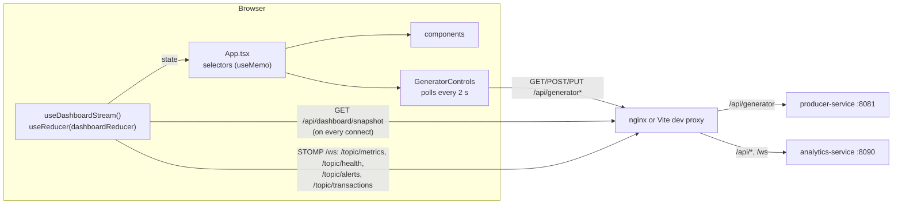

# `dashboard` — React live dashboard

[← Back to docs index](README.md)

A single-page **React 19 + TypeScript** app built with **Vite**. It shows near-real-time metrics, cluster health, alerts and a sampled transaction feed, and has controls for the event generator. In production **nginx** serves it and proxies `/api` and `/ws` to the two backends, so the browser only talks to one origin.

| | |
|---|---|
| Libraries | `react`/`react-dom` 19, `recharts` 3 (charts), `@stomp/stompjs` 7 (STOMP over WebSocket) |
| Dev tooling | Vite 8, TypeScript 7, Vitest 5 + jsdom + Testing Library, oxlint |
| Dev server | `npm run dev` → http://localhost:5173 (proxies to `localhost:8090` / `localhost:8081`) |
| Production | `nginx:1.29-alpine` on container port 80 → host `3000` (`DASHBOARD_PORT`) |
| Talks to | analytics-service: `GET /api/dashboard/snapshot`, WebSocket `/ws`. producer-service: `/api/generator*`. |

## Data flow in the browser



1. `useDashboardStream` opens a STOMP client. On every (re)connect it marks the state `connected`, fetches the REST snapshot, and subscribes to the four topics.
2. Each message becomes a reducer action (`metrics`, `health`, `alert`, `transaction`). The reducer ignores metrics pushes older than what it has, de-duplicates alerts, and bounds the lists.
3. `App` derives chart data with the pure selectors and renders the components.
4. `GeneratorControls` talks to the producer REST API on its own and compares the generator's injected counters with the stream's detected totals.

## Folder layout

```
dashboard/
├── Dockerfile, nginx.conf, .dockerignore
├── package.json, package-lock.json
├── vite.config.ts, tsconfig.json, tsconfig.app.json, tsconfig.node.json
├── .oxlintrc.json, .gitignore
├── index.html
├── README.md                    (Vite template boilerplate)
├── public/  favicon.svg, icons.svg
└── src/
    ├── main.tsx, App.tsx, index.css, types.ts
    ├── components/  AlertsPanel, BreakdownChart, ChartTooltip, GeneratorControls, Header, HealthStrip,
    │                KpiTiles, LiveFeed, PipelinePanel, Sparkline, VolumeChart, WindowCountChart,
    │                components.test.tsx
    ├── lib/         api.ts, format.ts (+test), selectors.ts (+test)
    ├── state/       dashboardReducer.ts (+test), useDashboardStream.ts
    └── test/        fixtures.ts, setup.ts
```

---

## Build, tooling and serving

### [`package.json`](../dashboard/package.json)

Package `txn-dashboard` 1.0.0, ES modules.

| Script | Command | Purpose |
|---|---|---|
| `dev` | `vite` | dev server with HMR and proxies (port 5173) |
| `build` | `tsc -b && vite build` | type-check all project references, then bundle to `dist/` |
| `lint` | `oxlint` | lint with `.oxlintrc.json` |
| `preview` | `vite preview` | serve the built `dist/` |
| `test` | `vitest run` | run the unit/component tests once |
| `test:watch` | `vitest` | watch mode |

`package-lock.json` pins the full dependency tree (`npm ci` in Docker).

### [`vite.config.ts`](../dashboard/vite.config.ts)

- `plugins: [react()]`.
- `server.port: 5173`. `server.proxy` mirrors the nginx routing: `/api/generator` → `PRODUCER_URL` (default `http://localhost:8081`), `/api` → `ANALYTICS_URL` (default `http://localhost:8090`), `/ws` → analytics with `ws: true`. The more specific `/api/generator` entry comes first.
- `test`: Vitest with `environment: 'jsdom'`, `globals: true`, `setupFiles: ['./src/test/setup.ts']`, `css: false`.

### [`tsconfig.json`](../dashboard/tsconfig.json), [`tsconfig.app.json`](../dashboard/tsconfig.app.json), [`tsconfig.node.json`](../dashboard/tsconfig.node.json)

- `tsconfig.json` has no files of its own; it references the other two (a solution-style config for `tsc -b`).
- `tsconfig.app.json` covers `src/`: ES2023 + DOM, `moduleResolution: bundler`, `jsx: react-jsx`, `noEmit` (Vite does the bundling), strict unused checks, `erasableSyntaxOnly`, `verbatimModuleSyntax`, `types: ["vite/client"]`.
- `tsconfig.node.json` covers `vite.config.ts`: ES2023, `module: nodenext`, `types: ["node"]`.

### [`.oxlintrc.json`](../dashboard/.oxlintrc.json)

oxlint with the `react`, `typescript` and `oxc` plugins. `react/rules-of-hooks` is an error; `react/only-export-components` is a warning (constant exports allowed).

### [`index.html`](../dashboard/index.html)

The Vite entry HTML: title "Transaction Analytics", favicon `/favicon.svg`, `<div id="root">`, and a module script `/src/main.tsx`. The smoke test checks that the served page contains `<div id="root">`.

### [`Dockerfile`](../dashboard/Dockerfile)

1. **build** (`node:22-alpine`): `npm ci --no-audit --no-fund`, copy the sources, `npm run build`.
2. **runtime** (`nginx:1.29-alpine`): copies `nginx.conf` to `/etc/nginx/conf.d/default.conf` and `dist/` to `/usr/share/nginx/html`, exposes 80. The `HEALTHCHECK` runs `wget -qO- http://127.0.0.1/healthz`.

[`.dockerignore`](../dashboard/.dockerignore) excludes `node_modules` and `dist` from the build context.

### [`nginx.conf`](../dashboard/nginx.conf)

| Location | Behaviour |
|---|---|
| `map $http_upgrade $connection_upgrade` | sets `Connection: upgrade` when the client asks for a WebSocket upgrade, otherwise `close` |
| `upstream analytics` / `upstream producer` | `analytics-service:8090` / `producer-service:8081` (compose DNS names) |
| `= /healthz` | returns `200 ok` (container health check), no access log |
| `/api/generator` | → producer (the longer prefix wins over `/api/`) |
| `/api/` | → analytics |
| `/ws` | → analytics with HTTP/1.1, `Upgrade` and `Connection` headers, 1 h read/send timeouts (STOMP over WebSocket) |
| `/assets/` | `expires 1y`, `Cache-Control: public, immutable` (Vite adds content hashes to asset names) |
| `/` | `try_files $uri /index.html` (SPA fallback), `Cache-Control: no-cache` |

### [`.gitignore`](../dashboard/.gitignore)

The standard Vite ignore list: logs, `node_modules`, `dist`, `dist-ssr`, `*.local`, editor folders.

### [`README.md`](../dashboard/README.md)

Unchanged Vite "React + TypeScript + Vite" template text (plugins, React Compiler, oxlint type-aware rules). It has nothing specific to this project; this page documents the dashboard instead.

### `public/`

- [`favicon.svg`](../dashboard/public/favicon.svg): the tab icon, referenced from `index.html`.
- [`icons.svg`](../dashboard/public/icons.svg): an SVG sprite from the Vite template (social icons such as Bluesky). Nothing in `src/` references it.

---

## `src/` entry and global files

### [`main.tsx`](../dashboard/src/main.tsx)

Imports `index.css`, then `createRoot(document.getElementById('root')!)` and renders `<App />` inside `<StrictMode>`.

### [`App.tsx`](../dashboard/src/App.tsx)

The page layout and theme handling.

| Item | Description |
|---|---|
| `type Theme = 'light' \| 'dark'` | |
| **`initialTheme()`** | Returns the saved `localStorage.theme` if it is valid, otherwise the OS `prefers-color-scheme`. Storage errors are ignored. |
| **`App()`** (default export) | `state = useDashboardStream()`. Keeps `theme` in state; an effect sets `document.documentElement.dataset.theme` and saves it. With `m = state.metrics`, memoizes `points = toChartPoints(m.windows)` and `lastMinuteBreakdown` for `byType`, `byChannel` and `byRegion`. `windowS` and `graceS` come from `m.windowMs`/`graceMs` (defaults 10/30). |

The layout, top to bottom:
1. `Header` (connection state, Streams state, theme toggle)
2. `HealthStrip` (brokers, replication, lag, latency)
3. `KpiTiles`
4. `WindowCountChart` and `VolumeChart` (`charts-main` grid, 3fr/2fr)
5. Three `BreakdownChart`s: by type, channel, region (`charts-side`)
6. `PipelinePanel` (totals)
7. `LiveFeed` beside a column with `AlertsPanel` and `GeneratorControls` (`bottom` grid)

### [`index.css`](../dashboard/src/index.css)

All styling, with no CSS framework.
- **Design tokens** on `:root`: page and surface colours, text levels, grid/axis, `--series-1` (blue, approved/volume), `--series-2` (orange, declined), status colours `--good/--warning/--serious/--critical`, radius, font.
- **Dark theme**: the same tokens redefined under `@media (prefers-color-scheme: dark)` when no explicit light theme is set (`:root:where(:not([data-theme='light']))`), and under `:root[data-theme='dark']`.
- Component classes: `.app` (max 1440 px grid), `.header`, `.pill`, `.dot.{good,warning,critical,muted}`, `.btn(.primary)`, `.card`, `.grid`, `.kpis`, `.charts-main`, `.charts-side`, `.bottom` (one column under 1100 px), `.tile`, `.health`, `.broker`, `.badge`, `.status-text`, `.meter`, table styles with `.num` (tabular numbers), `tr.flash` (highlight animation for the newest row), `.alerts`, `.legend`, `.swatch`, `.tooltip`, `.controls`, `.slider`, `.row-actions`, `.truth` (injected vs detected grid), `.pipeline`, `.empty`, `.banner`, `.visually-hidden` (not used).

### [`types.ts`](../dashboard/src/types.ts)

TypeScript interfaces that **mirror the backend JSON** exactly. `BigDecimal` values arrive as JSON numbers and `Instant`s as ISO strings.

| Interface | Mirrors |
|---|---|
| `Bucket` | `model.Bucket` |
| `WindowAgg` | `model.WindowAgg` |
| `WindowPoint` | `dashboard.WindowPoint` |
| `Kpis` | `dashboard.Kpis` |
| `PipelineTotals` | `model.PipelineTotals` |
| `LatencyStats` | `LatencyTracker.Stats` |
| `DashboardUpdate` | `dashboard.DashboardUpdate` |
| `BrokerStatus`, `ClusterHealth` | `health.ClusterHealth(.BrokerStatus)` |
| `Alert` | `model.Alert` (`type: 'HIGH_VALUE' \| 'VELOCITY'`) |
| `TransactionEvent` | `common.model.TransactionEvent` |
| `Snapshot` | `DashboardController.Snapshot` |
| `GeneratorSettings`, `GeneratorStats`, `GeneratorStatus` | producer-service records |
| `ConnectionState` | `'connecting' \| 'connected' \| 'reconnecting'` (client only) |

---

## `src/state/`

### [`useDashboardStream.ts`](../dashboard/src/state/useDashboardStream.ts)

**`useDashboardStream()`** → `DashboardState`. A React hook that owns the live connection.
- `useReducer(dashboardReducer, initialState)`.
- One effect (runs on mount) that:
  - defines `loadSnapshot()`: `api.snapshot()` → dispatches `snapshot` (unless unmounted); errors are ignored.
  - creates a `@stomp/stompjs` `Client` with `brokerURL: webSocketUrl()`, `reconnectDelay: 2000`, heart-beats 10 s in and out.
  - `onConnect`: dispatches `connection: connected`, calls `loadSnapshot()` (also after every reconnect, to fill any gap), and subscribes to `/topic/metrics`, `/topic/health`, `/topic/alerts`, `/topic/transactions`. Each message body is JSON-parsed and dispatched.
  - `onWebSocketClose`: dispatches `connection: reconnecting`.
  - `client.activate()`. The cleanup sets `cancelled` and calls `client.deactivate()`.

### [`dashboardReducer.ts`](../dashboard/src/state/dashboardReducer.ts)

A pure reducer for all live state.

| Export | Description |
|---|---|
| `MAX_ALERTS = 50`, `MAX_TRANSACTIONS = 30` | list bounds |
| `interface DashboardState` | `connection`, `metrics`, `health`, `alerts`, `transactions`, `lastMessageAt` |
| `initialState` | `connecting`, nulls, empty lists |
| `type Action` | `snapshot` \| `metrics` \| `health` \| `alert` \| `transaction` \| `connection` |
| `mergeAlerts(incoming, existing)` (internal) | concatenates incoming first, de-duplicates by `alertId` keeping the first copy, truncates to `MAX_ALERTS` |
| **`dashboardReducer(state, action)`** | **snapshot**: keeps the current metrics if their `generatedAt` is newer than the snapshot's; keeps existing health if any; merges alerts (existing first); uses snapshot transactions only if the feed is empty. **metrics**: ignored if older than the current `generatedAt` (out-of-order pushes); otherwise stored with `lastMessageAt = Date.now()`. **health**: replaced. **alert**: prepended via `mergeAlerts`. **transaction**: prepended, bounded to 30. **connection**: replaced. |

`lastMessageAt` is written but no component reads it.

---

## `src/lib/`

### [`api.ts`](../dashboard/src/lib/api.ts)

| Export | Description |
|---|---|
| `json<T>(res)` (internal) | throws `Error("<status> <statusText>")` for non-2xx, otherwise `res.json()` |
| `api.snapshot()` | `GET /api/dashboard/snapshot` → `Snapshot` |
| `api.generator()` | `GET /api/generator` → `GeneratorStatus` |
| `api.start()` / `api.stop()` | `POST /api/generator/start` / `stop` → `GeneratorStatus` |
| `api.updateSettings(s)` | `PUT /api/generator/settings` with a JSON body → `GeneratorStatus` |
| **`webSocketUrl()`** | `ws://` or `wss://` (matching the page protocol) + `location.host` + `/ws` |

All URLs are relative, so the same build works behind nginx or the Vite proxy.

### [`format.ts`](../dashboard/src/lib/format.ts)

Formatting with `Intl.NumberFormat('en-IN')` (Indian digit grouping). `null`, `undefined` and `NaN` give `'–'`. Four formatters are created once at module load and reused: `inrCompact` (₹, compact, 1 decimal), `inrFull` (₹, no decimals), `countFmt` (grouped integer) and `compactCount` (compact number).

| Function | Output |
|---|---|
| **`formatInr(value)`** | `₹12,345`; compact lakh/crore at or above 1,00,000 (`₹2.5L`, `₹3.4Cr`) |
| **`formatCount(value)`** | `1,234`; compact at or above 1,00,000 |
| **`formatPercent(ratio, digits = 1)`** | `0.9654` → `96.5%` |
| **`formatMs(ms)`** | `< 1000` → `250 ms`, otherwise `1.5 s`; negative → `–` |
| **`formatClock(epochMs)`** | `HH:MM:SS` (en-GB, 24 h). Not used by any component. |
| **`formatAmount(amount, currency)`** | currency-formatted in the event's own currency (falls back to `"<n> <CUR>"` for an unknown code) |

### [`selectors.ts`](../dashboard/src/lib/selectors.ts)

Pure functions that turn `WindowPoint[]` into chart data.

| Export | Description |
|---|---|
| `interface BreakdownRow { key, count, volume }` | |
| **`lastMinuteBreakdown(windows, field)`** | `field` is `byType`, `byChannel` or `byRegion`. Takes complete windows only, keeps those with `start ≥ latestEnd − 60 s`, sums the buckets per key, and sorts by volume, largest first. |
| `interface ChartPoint { start, label, approved, declined, volume, complete, lateAccepted }` | |
| **`toChartPoints(windows)`** | sorts by start and maps each window to a `ChartPoint` (`label` = `HH:MM:SS` of the start) |
| **`tpsSeries(windows, windowMs)`** | complete windows sorted by start → `count / windowSeconds` (for the sparkline) |

---

## `src/components/`

| Component | Props | What it renders |
|---|---|---|
| [`Header`](../dashboard/src/components/Header.tsx) | `connection`, `streamsState`, `theme`, `onToggleTheme` | Title and subtitle. A **connection pill** (`Live` green / `Connecting…` amber / `Reconnecting…` red, `data-testid="connection"`), a **Streams state pill** (green only when `RUNNING`), and the theme toggle button. `CONNECTION` maps each state to a CSS class and label; `streamsOk` is `streamsState === 'RUNNING'`. |
| [`HealthStrip`](../dashboard/src/components/HealthStrip.tsx) | `health: ClusterHealth \| null`, `latency` | `null` → "Waiting for cluster health…". `reachable=false` → a red `role="alert"` banner "Kafka cluster unreachable" with the error. Otherwise one card per broker (`data-testid="broker-<id>"`) with `✓ Up` / `✕ Down` text (not only colour), an "Active controller" badge, "Leader for X of N partitions · replica of Y", and a meter showing its share of leaders. Plus a **Replication** card (brokers up, under-replicated, offline) and a **Pipeline** card (consumer lag, latency p50/p95). |
| [`KpiTiles`](../dashboard/src/components/KpiTiles.tsx) | `metrics`, `alertCount` | Eight tiles: Throughput (tps + peak + a `Sparkline` of `tpsSeries`), Approved volume in the last minute (+ count), Average ticket, Approval rate, Late events (corrected · too late), Out of order (+ gaps), Duplicates removed (of received), Alerts (number held in the client). The internal `Tile` component renders label, value, optional children and foot. Before data arrives every value is `–`. |
| [`Sparkline`](../dashboard/src/components/Sparkline.tsx) | `values`, `width=120`, `height=28` | An inline SVG path scaled to the max value, with the last point drawn as an accent dot. Fewer than 2 values → an empty SVG. |
| [`WindowCountChart`](../dashboard/src/components/WindowCountChart.tsx) | `points`, `windowS`, `graceS` | A Recharts **stacked bar** chart, approved (series-1) plus declined (series-2), per event-time window over the last 5 min. Open (incomplete) windows are drawn at 40 % opacity with `Cell`. The `Tip` tooltip shows approved/declined/total and a note: "Window still open", or "N late event(s) added after the window ended". |
| [`VolumeChart`](../dashboard/src/components/VolumeChart.tsx) | `points`, `windowS` | A Recharts **area** chart of approved INR volume per window; the Y axis uses `formatInr`. The tooltip marks open windows. |
| [`BreakdownChart`](../dashboard/src/components/BreakdownChart.tsx) | `title`, `rows: BreakdownRow[]` | A horizontal single-series bar chart of approved volume per category over the last minute, with value labels. Height grows with the number of rows. `pretty()` turns `PAYMENT` into `Payment`. The tooltip shows volume and count. |
| [`ChartTooltip`](../dashboard/src/components/ChartTooltip.tsx) → `TooltipBox` | `title`, `rows: {name, value, color?}[]`, `note?` | The tooltip body shared by all charts, with an optional colour swatch per row. |
| [`PipelinePanel`](../dashboard/src/components/PipelinePanel.tsx) | `totals` | "Stream processing since start": the `ITEMS` array defines tiles for `received`, `processed` (labelled "Counted"), `duplicates`, `lateAccepted`, `lateDropped`, `outOfOrder`, each with a help text explaining how the topology treats that kind of event. |
| [`LiveFeed`](../dashboard/src/components/LiveFeed.tsx) | `transactions` | A table of the sampled feed, newest first, the newest row flashing: time (event time), account, sequence (`% 1,000,000`, because production sequences start at epoch-seconds × 10⁶), type, channel, amount in its own currency, status (`✓ Approved` / `✕ Declined`), region. |
| [`AlertsPanel`](../dashboard/src/components/AlertsPanel.tsx) | `alerts` | A list of alerts with a type badge (`⚠ High value` red border / `⚡ Velocity` orange border), account, message and detection time. The hint text hard-codes the thresholds (₹1,00,000 and > 10/min). |
| [`GeneratorControls`](../dashboard/src/components/GeneratorControls.tsx) | `totals` | Polls `api.generator()` every 2 s (`refresh`). Shows Running/Stopped with a Start/Stop button. A **rate slider** (0–2000, step 10) and four **ratio sliders** (`SLIDERS`: late, out-of-order, duplicates up to 20 %; high-value up to 5 %) edit a local `draft`. **Apply** (enabled only when the draft differs) calls `updateSettings`; **Reset** restores the draft. The **Injected vs Detected** grid compares generator counters with stream totals from a common **baseline**, taken when both first load or when the user clicks "Reset comparison", because the two services start counting at different times. `delta(now, base)` formats the difference. `run(fn)` wraps actions with a busy state and error handling. An error shows "Generator unavailable (…)". |

---

## Tests

Run with `cd dashboard && npm test` (Vitest + jsdom).

| File | Covers |
|---|---|
| [`src/test/setup.ts`](../dashboard/src/test/setup.ts) | registers the `@testing-library/jest-dom` matchers for Vitest |
| [`src/test/fixtures.ts`](../dashboard/src/test/fixtures.ts) | builders with sensible defaults and partial overrides: `agg()`, `win(start, partial, complete)`, `metrics()`, `health()` (3 brokers, 18 partitions, controller 2), `alert(id, type)`, `txn(id)` |
| [`state/dashboardReducer.test.ts`](../dashboard/src/state/dashboardReducer.test.ts) | snapshot applied; an older snapshot doesn't overwrite newer live metrics; out-of-order metrics pushes ignored; alerts newest first, de-duplicated and bounded at 50; feed bounded at 30; connection state |
| [`lib/selectors.test.ts`](../dashboard/src/lib/selectors.test.ts) | last-minute breakdown uses complete windows only within 60 s, sorted by volume; chart points sorted; TPS per complete window |
| [`lib/format.test.ts`](../dashboard/src/lib/format.test.ts) | INR grouping and lakh/crore compaction, counts, percent, ms/s, placeholders |
| [`components/components.test.tsx`](../dashboard/src/components/components.test.tsx) | **Header** Live/Reconnecting. **HealthStrip** leadership text, controller badge, "Down" as text, unreachable banner. **KpiTiles** values and placeholders. **AlertsPanel** type labels. **GeneratorControls** (with `fetch` mocked): stop → `POST /api/generator/stop`; Apply enabled only after a change and sends the new rate; injected vs detected from the baseline; error when the producer returns 502. |
