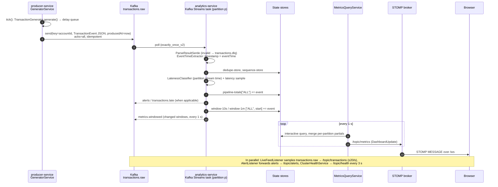

# Data flow and interfaces reference

[← Back to docs index](README.md)

One place for every interface between components: Kafka topics (who writes, who reads, key, value format), Kafka Streams state stores, STOMP destinations and REST endpoints.

## End-to-end path of one transaction



## Kafka topics

| Topic | Partitions / RF / retention | Key | Value | Producer (code) | Consumer (code) |
|---|---|---|---|---|---|
| `transactions.raw` | 6 / 3 / 1 d | `accountId` (String) | `TransactionEvent` JSON | `KafkaEventSender.send` | `TransactionTopology` (`source-raw`), `LiveFeedListener.onEvent` |
| `transactions.dlq` | 3 / 3 / 7 d | the original key | **original raw bytes** | topology `sink-dlq` | – |
| `transactions.late` | 3 / 3 / 7 d | `accountId` | `TransactionEvent` JSON | topology `sink-late` | – |
| `alerts` | 3 / 3 / 1 d | `accountId` | `Alert` JSON | topology `sink-alerts-hv`, `sink-alerts-velocity` | `AlertListener.onAlert` |
| `metrics.windowed` | 3 / 3 / 1 h | `<size>@<windowStart>@p<partition>`, e.g. `10s@1794477600000@p3` | `WindowMetrics` JSON (a per-partition partial) | topology `sink-metrics-10s`, `sink-metrics-1m` | – (an external consumer should sum partials with the same size and start) |
| `txn-analytics-*-changelog` | internal, RF 3 | store key | store value | Kafka Streams | Kafka Streams (restore) |
| `txn-analytics-velocity-count-…` | internal | | | Kafka Streams (velocity `count`) | |

Consumer groups:

| Group | Who | Notes |
|---|---|---|
| `txn-analytics` | Kafka Streams | committed offsets give the "consumer lag" shown on the dashboard |
| `dashboard-feed-${HOSTNAME}` | `LiveFeedListener` | `auto.offset.reset=latest`, one group per instance |
| `dashboard-alerts-${HOSTNAME}` | `AlertListener` | on assignment, seeks to 40 records before the end of each partition |

### Message examples

`TransactionEvent` (on `transactions.raw` and `transactions.late`):

```json
{"eventId":"0b6c…","accountId":"ACC-001234","sequenceNo":1794477600000017,"type":"PAYMENT","channel":"POS",
 "status":"APPROVED","amount":1499.00,"currency":"INR","merchantCategory":"GROCERY","region":"WEST",
 "eventTime":"2026-11-12T10:00:01.200Z","producedAt":"2026-11-12T10:00:01.231Z"}
```

`Alert` (on `alerts`):

```json
{"alertId":"…","type":"HIGH_VALUE","accountId":"ACC-000042","eventId":"…","amountInr":250000.00,"count":1,
 "eventTime":"2026-11-12T10:00:01Z","detectedAt":"2026-11-12T10:00:01.4Z","message":"High-value TRANSFER of INR 2,50,000.00 via MOBILE"}
{"alertId":"…","type":"VELOCITY","accountId":"ACC-000777","eventId":null,"amountInr":null,"count":11,
 "eventTime":"2026-11-12T10:00:00Z","detectedAt":"…","message":"More than 10 transactions within 1 minute"}
```

`WindowMetrics` (on `metrics.windowed`):

```json
{"size":"10s","start":1794477600000,"end":1794477610000,"partition":3,
 "agg":{"count":42,"approved":40,"declined":2,"volume":123456.78,"maxAmount":15000.00,"lateAccepted":1,"outOfOrder":0,
        "byType":{"PAYMENT":{"count":15,"volume":20000.00}},"byChannel":{…},"byRegion":{…},"byCurrency":{"INR":36,"USD":4,"EUR":2}}}
```

## Kafka Streams state stores

All in-memory with changelogs. See [analytics-service › TransactionTopology](analytics-service.md#transactiontopologyjava) for retention and caching.

| Store | Key → value | Written by | Read by |
|---|---|---|---|
| `dedupe-store` | eventId → timestamp | `DedupeProcessor` | `DedupeProcessor` |
| `sequence-store` | accountId → last seq | `SequenceCheckProcessor` | same |
| `pipeline-totals` | `"ALL"` → `PipelineTotals` (one per partition) | `TotalsProcessor` | `MetricsQueryService` |
| `window-10s` | (`"ALL"`, windowStart) → `WindowAgg` | `WindowAggregateProcessor` | `MetricsQueryService`, the processor's `flush` |
| `window-1m` | (`"ALL"`, windowStart) → `WindowAgg` | `WindowAggregateProcessor` | `MetricsQueryService`, the processor's `flush` |
| `velocity-counts` | (accountId, windowStart) → count | DSL `count` | the velocity alert filter |

## STOMP over WebSocket (analytics-service `/ws`)

Plain WebSocket (no SockJS), simple broker, 10 s heart-beats. Clients only subscribe; there are no `/app` handlers.

| Destination | Payload | Sent by | Frequency |
|---|---|---|---|
| `/topic/metrics` | `DashboardUpdate` | `DashboardPublisher.publish` | every `analytics.push-interval-ms` (1 s) |
| `/topic/health` | `ClusterHealth` | `ClusterHealthService.refresh` | every `analytics.health-interval-ms` (3 s) |
| `/topic/alerts` | `Alert` | `AlertListener.onAlert` | per alert |
| `/topic/transactions` | `TransactionEvent` | `LiveFeedListener.onEvent` | sampled, ≤ `live-feed-max-per-second` (20/s) |

`DashboardUpdate` shape (abbreviated):

```json
{"generatedAt":1794477661000,"streamsState":"RUNNING","windowMs":10000,"graceMs":30000,
 "kpis":{"tps":51.2,"volumeLastMin":4567890.12,"countLastMin":3050,"avgTicket":1525.37,"approvalRate":0.968,"peakTps":63.0},
 "windows":[{"start":1794477360000,"end":1794477370000,"complete":true,"agg":{…WindowAgg…}}, …],
 "summaryWindows":[…1-minute WindowPoints…],
 "totals":{"received":102345,"processed":99876,"duplicates":1012,"outOfOrder":2987,"gaps":2950,"lateAccepted":1200,"lateDropped":1257,"maxEventTime":1794477660990},
 "latency":{"p50Ms":38,"p95Ms":210,"p99Ms":540,"maxMs":1200,"samples":4096}}
```

`ClusterHealth` shape:

```json
{"timestamp":1794477661000,"reachable":true,"activeControllerId":2,"controllerVoters":[1,2,3],
 "brokers":[{"id":1,"host":"kafka-1:9092","up":true,"leaderPartitions":6,"replicaPartitions":18}, …],
 "totalPartitions":18,"underReplicated":0,"offlinePartitions":0,"consumerLag":12,"error":null}
```

## REST endpoints

| Method + path (direct) | Through nginx / Vite | Service | Handler | Response |
|---|---|---|---|---|
| `GET :8090/api/dashboard/snapshot` | `GET /api/dashboard/snapshot` | analytics | `DashboardController.snapshot` | `{metrics, health, alerts[], transactions[]}` |
| `GET :8081/api/generator` | `/api/generator` | producer | `GeneratorController.status` | `GeneratorStatus` |
| `POST :8081/api/generator/start` | `/api/generator/start` | producer | `GeneratorController.start` | `GeneratorStatus` |
| `POST :8081/api/generator/stop` | `/api/generator/stop` | producer | `GeneratorController.stop` | `GeneratorStatus` |
| `PUT :8081/api/generator/settings` | `/api/generator/settings` | producer | `GeneratorController.update` | `GeneratorStatus`, or 400 on validation errors |
| `GET :808x/actuator/health[/readiness\|/liveness]` | – | both | Spring Actuator | used by the Docker health checks |
| `GET :808x/actuator/info`, `/actuator/metrics` | – | both | Spring Actuator | |
| `GET /healthz` | – | dashboard nginx | `nginx.conf` | `ok` |

## Event counters: how producer and stream numbers relate

| Generator (`GeneratorStats`) | Stream (`PipelineTotals`) | Relationship after the system drains |
|---|---|---|
| `acked` | `received` | equal (exactly-once, see `accuracy-test.sh`). Records that fail parsing are not counted in `received`. |
| `injectedDuplicates` | `duplicates` | equal |
| `injectedLate` | `lateAccepted + lateDropped` | detected ≤ injected (short delays stay inside their window) |
| `injectedOutOfOrder` | `outOfOrder` | detected ≥ injected (late events also arrive after newer events of the same account) |
| – | `processed` | `= received − duplicates − lateDropped` |
