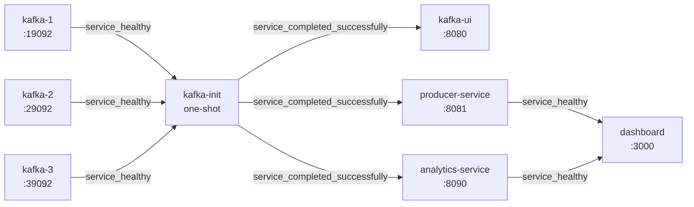

# Infrastructure, build and root files

[← Back to docs index](README.md)

This page covers everything outside the four code modules: Docker Compose, the Kafka cluster and topic set-up (`infra/`), the Maven root build and wrapper, environment configuration, ignore files, and the root Markdown files.

## Root folder

| File | Purpose |
|---|---|
| [`docker-compose.yml`](../docker-compose.yml) | the whole stack: 3 Kafka nodes, topic init, Kafka UI, both services, dashboard |
| [`.env`](../.env) | variables Compose substitutes (cluster id, image, ports, generator defaults) |
| [`pom.xml`](../pom.xml) | Maven aggregator/parent for `txn-common`, `producer-service`, `analytics-service` |
| [`mvnw`](../mvnw), [`mvnw.cmd`](../mvnw.cmd), [`.mvn/wrapper/maven-wrapper.properties`](../.mvn/wrapper/maven-wrapper.properties) | Maven Wrapper, so no local Maven install is needed |
| [`.gitignore`](../.gitignore) | `target/`, `node_modules/`, `dashboard/dist/`, `.idea/`, `*.iml`, `.DS_Store` |
| [`.dockerignore`](../.dockerignore) | keeps `target`, `node_modules`, `dashboard/dist`, `.git`, `.idea`, `*.iml`, `docs`, `scripts` out of the backend build context |
| [`README.md`](../README.md) | project overview, how to run, test levels, how each streaming concern is handled |
| [`IMPLEMENTATION_PLAN.md`](../IMPLEMENTATION_PLAN.md) | the original design and plan (architecture, topics, event model, test plan, milestones). Parts differ from the final code; see [Observations](observations.md). |
| `infra/kafka/create-topics.sh` | topic creation script, run by the `kafka-init` container (below) |
| `docs/` | this documentation plus the operations [RUNBOOK](RUNBOOK.md) |
| `scripts/` | system test scripts, see [scripts.md](scripts.md) |

---

## [`docker-compose.yml`](../docker-compose.yml)

Compose project name: **`txn-analytics`**. All services share the user-defined bridge network **`txn-net`**.



### Shared anchors

- **`x-kafka-common`**: image `${KAFKA_IMAGE:-apache/kafka:4.4.0}`, `restart: unless-stopped`, `stop_grace_period: 60s` (allows a controlled shutdown that hands leadership over, instead of a SIGKILL after 10 s), network `txn-net`. Health check: `kafka-broker-api-versions.sh --bootstrap-server localhost:9092` every 15 s (timeout 15 s, 10 retries, 30 s start period).
- **`x-kafka-env`**: KRaft settings common to all three nodes.

| Variable | Value | Effect |
|---|---|---|
| `CLUSTER_ID` | `${KAFKA_CLUSTER_ID}` | the same KRaft cluster id on every node (from `.env`) |
| `KAFKA_PROCESS_ROLES` | `broker,controller` | combined mode: each node is a broker and a controller |
| `KAFKA_CONTROLLER_QUORUM_VOTERS` | `1@kafka-1:9093,2@kafka-2:9093,3@kafka-3:9093` | 3-voter quorum: 1 active + 2 standby controllers |
| `KAFKA_CONTROLLER_LISTENER_NAMES` | `CONTROLLER` | |
| `KAFKA_INTER_BROKER_LISTENER_NAME` | `INTERNAL` | |
| `KAFKA_LISTENER_SECURITY_PROTOCOL_MAP` | `INTERNAL:PLAINTEXT,CONTROLLER:PLAINTEXT,EXTERNAL:PLAINTEXT` | no TLS/SASL |
| `KAFKA_LOG_DIRS` | `/var/lib/kafka/data` | on a named volume |
| `KAFKA_AUTO_CREATE_TOPICS_ENABLE` | `false` | topics only come from `kafka-init` or Kafka Streams |
| `KAFKA_DEFAULT_REPLICATION_FACTOR` | `3` | |
| `KAFKA_MIN_INSYNC_REPLICAS` | `2` | with `acks=all`, a write needs 2 in-sync copies, so the cluster survives 1 broker loss without data loss |
| `KAFKA_OFFSETS_TOPIC_REPLICATION_FACTOR` | `3` | `__consumer_offsets` |
| `KAFKA_TRANSACTION_STATE_LOG_REPLICATION_FACTOR` / `_MIN_ISR` | `3` / `2` | `__transaction_state` (exactly-once) |
| `KAFKA_UNCLEAN_LEADER_ELECTION_ENABLE` | `false` | an out-of-date replica never becomes leader |
| `KAFKA_AUTO_LEADER_REBALANCE_ENABLE` | `true` | preferred leaders come back after a broker restarts |
| `KAFKA_GROUP_INITIAL_REBALANCE_DELAY_MS` | `0` | faster consumer start |
| `KAFKA_NUM_PARTITIONS` | `3` | default for topics created without an explicit count |
| `KAFKA_HEAP_OPTS` | `${KAFKA_HEAP:--Xms512m -Xmx512m}` | |

### Services

| Service | Image / build | Ports (host:container) | Depends on | Notes |
|---|---|---|---|---|
| `kafka-1` | `apache/kafka:4.4.0` | `19092:19092` | – | `KAFKA_NODE_ID=1`; listeners `INTERNAL://:9092`, `CONTROLLER://:9093`, `EXTERNAL://:19092`; advertised `INTERNAL://kafka-1:9092`, `EXTERNAL://localhost:19092`; volume `kafka-1-data` |
| `kafka-2` | same | `29092:29092` | – | node 2, external port 29092, volume `kafka-2-data` |
| `kafka-3` | same | `39092:39092` | – | node 3, external port 39092, volume `kafka-3-data` |
| `kafka-init` | same image | – | all three brokers **healthy** | mounts `./infra/kafka/create-topics.sh` read-only and runs it with bash; `restart: "no"` (one-shot, should exit 0) |
| `kafka-ui` | `kafbat/kafka-ui:v1.5.0` | `${KAFKA_UI_PORT:-8080}:8080` | `kafka-init` completed successfully | cluster `txn-cluster` → `kafka-1:9092,kafka-2:9092,kafka-3:9092`; `DYNAMIC_CONFIG_ENABLED=false` |
| `producer-service` | built from `producer-service/Dockerfile` (context `.`), tagged `txn-analytics/producer-service:1.0.0` | `${PRODUCER_PORT:-8081}:8081` | `kafka-init` completed successfully | env: `KAFKA_BOOTSTRAP`, `GENERATOR_RATE`, `GENERATOR_AUTOSTART`, `JAVA_OPTS=-Xms256m -Xmx384m -XX:+ExitOnOutOfMemoryError`; `stop_grace_period: 60s` |
| `analytics-service` | built from `analytics-service/Dockerfile` (context `.`), tagged `txn-analytics/analytics-service:1.0.0` | `${ANALYTICS_PORT:-8090}:8090` | `kafka-init` completed successfully | volume `streams-state:/var/lib/streams`; env: `KAFKA_BOOTSTRAP`, `STREAMS_STATE_DIR=/var/lib/streams`, `STREAMS_REPLICATION_FACTOR=3`, `STREAMS_MIN_ISR=2`, `JAVA_OPTS=-Xms512m -Xmx768m …`; `stop_grace_period: 60s` (Streams closes cleanly, so no state restore on restart) |
| `dashboard` | built from `./dashboard`, tagged `txn-analytics/dashboard:1.0.0` | `${DASHBOARD_PORT:-3000}:80` | analytics-service **and** producer-service healthy | nginx serving the React build and proxying the APIs |

Inside the network, everything uses `kafka-N:9092`. From the host, use `localhost:19092,29092,39092` (the services' YAML defaults, so they also work when run from an IDE).

**Named volumes**: `kafka-1-data`, `kafka-2-data`, `kafka-3-data` (broker logs), `streams-state` (Kafka Streams local state). `docker compose down -v` removes them all, which is a full reset.

---

## [`.env`](../.env)

| Variable | Value | Used by |
|---|---|---|
| `KAFKA_CLUSTER_ID` | `vElOEmyBS2aYkCQrH2jzDw` | `CLUSTER_ID` on all brokers. Make a new one with `kafka-storage.sh random-uuid` (the comment in the file shows the command). |
| `KAFKA_IMAGE` | `apache/kafka:4.4.0` | brokers and `kafka-init` |
| `KAFKA_HEAP` | `-Xms512m -Xmx512m` | `KAFKA_HEAP_OPTS` |
| `DASHBOARD_PORT` | `3000` | dashboard host port |
| `KAFKA_UI_PORT` | `8080` | Kafka UI host port |
| `PRODUCER_PORT` | `8081` | producer-service host port. Compose maps `${PRODUCER_PORT}:8081`; the container itself always listens on 8081. |
| `ANALYTICS_PORT` | `8090` | analytics-service host port (same pattern) |
| `GENERATOR_RATE` | `50` | initial events/s |
| `GENERATOR_AUTOSTART` | `true` | start generating on boot |

---

## `infra/`

### [`infra/kafka/create-topics.sh`](../infra/kafka/create-topics.sh)

A bash script (`set -euo pipefail`) run by the one-shot `kafka-init` container. Safe to run more than once.

1. **`BS`** = `${BOOTSTRAP:-kafka-1:9092,kafka-2:9092,kafka-3:9092}`; **`KT`** = `/opt/kafka/bin/kafka-topics.sh`.
2. **Waits for 3 brokers**: up to 60 × 2 s, counting the `kafka-…` lines that `kafka-broker-api-versions.sh` prints.
3. **Pins the transaction protocol to v1.** It reads `transaction.version` from `kafka-features.sh describe`; if it is above 1, it runs `kafka-features.sh downgrade --feature transaction.version=1`, then prints the result. The comment and [RUNBOOK](RUNBOOK.md) explain why: with transactions v2 (KIP-890, the 4.x default), Kafka Streams' exactly-once producers hit `OUT_OF_ORDER_SEQUENCE_NUMBER`/`CONCURRENT_TRANSACTIONS` retry storms on changelog topics under load.
4. **`create()`** (`name partitions [--config …]`): `kafka-topics.sh --create --if-not-exists --replication-factor 3 --config min.insync.replicas=2` plus any extra config.
5. Creates the topics:

| Topic | Partitions | RF | min ISR | Retention |
|---|---|---|---|---|
| `transactions.raw` | 6 | 3 | 2 | 1 day (`86400000`) |
| `transactions.late` | 3 | 3 | 2 | 7 days (`604800000`) |
| `transactions.dlq` | 3 | 3 | 2 | 7 days |
| `metrics.windowed` | 3 | 3 | 2 | 1 hour (`3600000`) |
| `alerts` | 3 | 3 | 2 | 1 day |

6. Describes `transactions.raw` and prints "Topics ready."

Kafka Streams creates its own internal changelog topics (`txn-analytics-<store>-changelog`) at start-up, with RF 3 and min ISR 2 from `application.yml`.

---

## Maven build

### [`pom.xml`](../pom.xml) (root)

- Parent: `org.springframework.boot:spring-boot-starter-parent:4.1.2`. It manages plugin and dependency versions.
- Coordinates: `com.bank.txn:txn-analytics:1.0.0`, `packaging pom`, name "Banking Transaction Analytics".
- Modules: `txn-common`, `producer-service`, `analytics-service`, built in that order.
- Properties: `java.version` 21. `kafka.version` **4.4.0** overrides the Boot-managed Kafka client version to match the brokers; the comment says the Boot-managed 4.2.x client hit `OutOfSequence` errors with the 4.4 broker under exactly-once.

Useful commands (from the root):

```bash
./mvnw verify                                   # unit tests + Testcontainers ITs (needs Docker)
```

```bash
./mvnw -pl analytics-service -am package -DskipTests   # build one service and what it depends on
```

### [`mvnw`](../mvnw) / [`mvnw.cmd`](../mvnw.cmd) / [`.mvn/wrapper/maven-wrapper.properties`](../.mvn/wrapper/maven-wrapper.properties)

The standard Apache Maven Wrapper 3.3.2 scripts (Unix shell and Windows batch). `distributionType=only-script`: on first use the script downloads **Maven 3.9.16** from `repo.maven.apache.org` into `~/.m2/wrapper` and runs it. They honour `MVNW_REPOURL`, `MVNW_USERNAME`/`MVNW_PASSWORD` and `MVNW_VERBOSE`. Both Dockerfiles use `./mvnw`, so building the images needs no local Maven.

---

## Container images built by this repo

| Image | Dockerfile | Base images | Documented in |
|---|---|---|---|
| `txn-analytics/producer-service:1.0.0` | [`producer-service/Dockerfile`](../producer-service/Dockerfile) | `eclipse-temurin:21-jdk` → `21-jre` | [producer-service](producer-service.md#dockerfile) |
| `txn-analytics/analytics-service:1.0.0` | [`analytics-service/Dockerfile`](../analytics-service/Dockerfile) | `eclipse-temurin:21-jdk` → `21-jre` | [analytics-service](analytics-service.md#dockerfile) |
| `txn-analytics/dashboard:1.0.0` | [`dashboard/Dockerfile`](../dashboard/Dockerfile) | `node:22-alpine` → `nginx:1.29-alpine` | [dashboard](dashboard.md#dockerfile) |

## Local build outputs (not in git)

These may exist in a working copy and are ignored by `.gitignore`: `*/target/` (jars, surefire/failsafe reports), `dashboard/node_modules/`, `dashboard/dist/` (the production bundle) and `.idea/` (IntelliJ project files).
