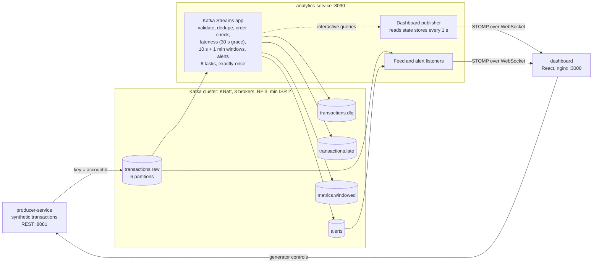

# Kafka Analytics Application Documentation

## Overview

Kafka Analytics is a real-time banking transaction analytics system. It generates synthetic transactions, cleans and aggregates them with Kafka Streams, raises fraud-style alerts and shows live metrics on a web dashboard that updates every second.

| Who | What they use it for |
| --- | --- |
| Operations or risk analyst | Watch throughput, volume, approval rate and alerts on the dashboard |
| Engineer running a demo | Change the generator's rate and error mix, stop brokers, and watch the system cope |
| Reviewer or tester | Compare what the generator injected with what the stream detected |

The system has three services and a three-node Kafka cluster, all started with one Docker Compose command.

## Architecture

*Architecture: all business logic runs in the Kafka Streams app. (The online doc has the same diagram as an image.)*

All business logic runs in the Kafka Streams app (highlighted). The dashboard never recomputes anything: the publisher reads the app's state stores once a second and pushes the result over WebSocket.

## Features

| Area | Feature | Details |
| --- | --- | --- |
| Event generator | Synthetic transactions | 5,000 accounts, 50 events/s by default (dashboard slider up to 2,000, API up to 5,000), four transaction types, five channels, four currencies, four regions |
| Event generator | Chaos controls | Late, out-of-order, duplicate and high-value ratios plus bursts, changeable at runtime from the dashboard or REST |
| Event generator | Ground-truth counters | Counts of every injected irregularity, shown beside what the stream detected |
| Stream processing | Validation and DLQ | Invalid records are kept, with their original bytes, in `transactions.dlq` |
| Stream processing | Deduplication | Repeated `eventId`s are counted once |
| Stream processing | Ordering checks | Out-of-order events and sequence gaps are flagged per account |
| Stream processing | Late-data handling | Late events within 30 s correct their window; later ones go to `transactions.late` |
| Stream processing | Windowed metrics | 10 s and 1 min tumbling windows with counts, volume and breakdowns by type, channel, region and currency |
| Alerts | High value | Any transaction of at least ₹1,00,000 |
| Alerts | Velocity | More than 10 transactions on one account within a 1-minute window |
| Dashboard | Header | Connection state, Streams state, light or dark theme |
| Dashboard | Health strip | Each broker up or down, active controller, partitions led, under-replicated partitions, consumer lag, latency p50/p95 |
| Dashboard | KPI tiles | Throughput, approved volume, average ticket, approval rate, late, out-of-order, duplicates, alerts |
| Dashboard | Charts | Transactions per 10 s window (open windows faded), volume per window, last-minute breakdowns by type, channel and region |
| Dashboard | Pipeline panel | Totals since start: received, counted, duplicates, late accepted, late dropped, out of order |
| Dashboard | Live feed and alerts | Sampled transactions table and alert list |
| Dashboard | Generator controls | Start, stop, rate and ratio sliders, and an injected-vs-detected comparison |

## Processing rules

Every transaction passes through the same steps, in this order, inside one Kafka Streams task per partition.

1. **Validate.** `eventId`, `accountId` and `eventTime` must be present, `amount` must be above 0, and type, channel, status and currency must be set. Anything else goes to `transactions.dlq` unchanged.
2. **Set event time.** The record's timestamp becomes the transaction's `eventTime`.
3. **Deduplicate.** An `eventId` seen within the last 2 minutes marks the event as a duplicate. Duplicates are counted but excluded from everything else.
4. **Check order.** Per account: a sequence number more than 1 above the last is a gap; one not above the last is out of order. Both are still counted.
5. **Classify lateness.** With window end = start of its 10 s window + 10 s: ON\_TIME if the window is still open; LATE\_ACCEPTED if stream time is past the end but within 30 s; LATE\_DROPPED after that.
6. **Update totals.** Received, processed, duplicates, out of order, gaps, late accepted and late dropped.
7. **Raise alerts.** High-value and velocity alerts on non-duplicate events go to `alerts`.
8. **Route too-late events.** LATE\_DROPPED events go to `transactions.late`.
9. **Aggregate.** Accepted events (not duplicate, not LATE\_DROPPED) are added to their 10 s and 1 min windows. Changed windows are published once per second.

### KPIs on the dashboard

| KPI | Formula | Window |
| --- | --- | --- |
| Throughput (TPS) | Count of the latest complete 10 s window ÷ 10 | Latest complete window |
| Peak TPS | Highest window count ÷ 10 | Last 5 min |
| Approved volume | Sum of approved amounts in INR | Last 60 s of complete windows |
| Average ticket | Approved volume ÷ approved count | Last 60 s |
| Approval rate | Approved count ÷ total count | Last 60 s |

All amounts are converted to INR with fixed rates: USD 83.50, EUR 90.20, GBP 105.80.

## Data model

All messages are JSON. The transaction event is shared by every service through the `txn-common` module.

### TransactionEvent (topic `transactions.raw`, key = `accountId`)

| Field | Type | Meaning |
| --- | --- | --- |
| `eventId` | string (UUID) | Globally unique; used for deduplication |
| `accountId` | string | Account, e.g. `ACC-00017`; also the Kafka key |
| `sequenceNo` | long | Per-account, always increasing; used for order checks |
| `type` | enum | DEPOSIT, WITHDRAWAL, TRANSFER, PAYMENT |
| `channel` | enum | ATM, POS, ONLINE, MOBILE, BRANCH |
| `status` | enum | APPROVED, DECLINED |
| `amount` | decimal | Amount in the transaction's currency |
| `currency` | enum | INR, USD, EUR, GBP |
| `merchantCategory` | string | Merchant category |
| `region` | enum | NORTH, SOUTH, EAST, WEST |
| `eventTime` | timestamp | When the transaction happened; drives the windows |
| `producedAt` | timestamp | When it was sent to Kafka; used for latency |

### Alert (topic `alerts`, key = `accountId`)

| Field | Meaning |
| --- | --- |
| `alertId` | Random UUID |
| `type` | HIGH\_VALUE or VELOCITY |
| `accountId` | Account that triggered it |
| `eventId`, `amountInr` | The transaction (high-value alerts only) |
| `count` | 1 for high value; the transaction count for velocity |
| `eventTime` | Transaction time, or the window start for velocity |
| `detectedAt` | When the stream raised it |
| `message` | Human-readable text, e.g. "High-value TRANSFER of INR 2,40,000.00 via ONLINE" |

### DashboardUpdate (WebSocket `/topic/metrics`, once per second)

| Field | Meaning |
| --- | --- |
| `generatedAt`, `streamsState` | Time of the update and the Streams state (RUNNING, REBALANCING, ...) |
| `windowMs`, `graceMs` | Window size and grace, so the UI can label charts |
| `kpis` | TPS, volume and count over the last minute, average ticket, approval rate, peak TPS |
| `windows` | 10 s windows from the last 5 min, each marked complete or open |
| `summaryWindows` | 1 min windows from the last 30 min |
| `totals` | Pipeline totals since start, summed over partitions |
| `latency` | p50, p95, p99 and max pipeline latency from the last 4,096 events |

## Interfaces

### Kafka topics

All topics have replication factor 3 and `min.insync.replicas=2`.

| Topic | Partitions | Retention | Written by | Read by |
| --- | --- | --- | --- | --- |
| `transactions.raw` | 6 | 1 day | producer-service | Kafka Streams app, live feed listener |
| `transactions.dlq` | 3 | 7 days | Kafka Streams app | Nobody yet (kept for inspection and replay) |
| `transactions.late` | 3 | 7 days | Kafka Streams app | Nobody yet (audit) |
| `alerts` | 3 | 1 day | Kafka Streams app | Alert listener |
| `metrics.windowed` | 3 | 1 hour | Kafka Streams app | Nobody yet (per-partition window partials) |

### REST endpoints

| Method and path | Service | Purpose |
| --- | --- | --- |
| `GET /api/generator` | producer-service :8081 | Generator status, settings and injected counters |
| `POST /api/generator/start` | producer-service | Start generating |
| `POST /api/generator/stop` | producer-service | Stop generating |
| `PUT /api/generator/settings` | producer-service | Change rate and ratios (validated) |
| `GET /api/dashboard/snapshot` | analytics-service :8090 | Current metrics, cluster health, recent alerts and transactions for a newly opened page |
| `GET /actuator/health` | both | Liveness and readiness for Docker health checks |

### WebSocket (STOMP endpoint `/ws`)

| Destination | Sent | Content |
| --- | --- | --- |
| `/topic/metrics` | Every 1 s | DashboardUpdate |
| `/topic/health` | Every 3 s | Brokers, controller, replication and consumer lag |
| `/topic/transactions` | Up to 20 per second | Sampled transactions |
| `/topic/alerts` | As they happen | Alerts |

In Docker, nginx on port 3000 serves the dashboard and proxies `/api` and `/ws`, so the browser talks to one origin.

## Configuration reference

Settings live in each service's `application.yml`; ports and generator defaults can be overridden in `.env`.

### Analytics (`analytics.*`)

| Setting | Default | Effect |
| --- | --- | --- |
| `window-size` | 10s | Live window size |
| `summary-window-size` | 1m | Summary window size |
| `grace` | 30s | How long a window accepts late events |
| `high-value-threshold-inr` | 100000 | High-value alert threshold |
| `velocity-threshold` | 10 | Alert when an account exceeds this many transactions per velocity window |
| `velocity-window` | 1m | Velocity window size |
| `dedupe-retention` | 2m | How long event ids are remembered |
| `live-feed-max-per-second` | 20 | Live feed sampling cap |
| `chart-history` / `summary-history` | 5m / 30m | How much window history is pushed |
| `push-interval-ms` / `health-interval-ms` | 1000 / 3000 | Push rates for metrics and health |

### Kafka Streams

| Setting | Value | Why |
| --- | --- | --- |
| `application-id` | txn-analytics | Consumer group and prefix of internal topics |
| `processing.guarantee` | exactly\_once\_v2 | No double counting after failures |
| `num.stream.threads` | 2 | Parallel threads per instance |
| `commit.interval.ms` | 1000 | One transaction per second |
| `producer.transaction.timeout.ms` | 60000 | Rides out broker hand-offs |
| `statestore.cache.max.bytes` | 10485760 | 10 MB record cache |

### Generator (`generator.*`, also editable at runtime)

| Setting | Default | Allowed range |
| --- | --- | --- |
| `rate-per-second` | 50 | 0–5,000 |
| `accounts` | 5000 | 1–1,000,000 |
| `late-ratio` | 0.03 | 0–0.5 |
| `max-lateness-seconds` | 90 | 6–600 |
| `out-of-order-ratio` | 0.02 | 0–0.5 |
| `duplicate-ratio` | 0.01 | 0–0.5 |
| `high-value-ratio` | 0.005 | 0–0.5 |
| `burst-chance-per-second` | 0.05 | 0–1 |
| `burst-size` | 12 | 2–100 |

## Running and operating

Start everything with `docker compose up -d --build` (Docker with Compose and about 4 GB of free RAM). Containers start in health-check order: the three brokers, then `kafka-init` creates the topics, then the two services and Kafka UI, then the dashboard. On a fresh cluster Kafka Streams needs 30–40 s before it reports RUNNING.

| Address | What |
| --- | --- |
| http://localhost:3000 | Dashboard |
| http://localhost:8080 | Kafka UI: topics, partitions, consumer groups |
| http://localhost:8081/api/generator | Generator API |
| http://localhost:8090/api/dashboard/snapshot | Analytics snapshot |
| localhost:19092, 29092, 39092 | Kafka brokers from the host |

### What happens when something fails

| Failure | Behaviour |
| --- | --- |
| One broker down | Followers become leaders; writes continue with 2 in-sync replicas; no data loss |
| Active controller down | A standby controller takes over within seconds |
| Two brokers down | Writes are refused (`NOT_ENOUGH_REPLICAS`) and retried for up to 120 s; nothing is half-written |
| analytics-service restart | State is rebuilt from changelog topics and processing resumes at committed offsets, with no double counting |
| producer-service restart | Sequence numbers are seeded from the start time, so no false out-of-order events |
| Stream thread crash | The thread is replaced automatically |

### Everyday operations

- Status: `docker compose ps` (all healthy; `kafka-init` exited 0)
- Logs: `docker compose logs -f analytics-service`
- Stop and keep data: `docker compose stop`; full reset: `docker compose down -v`
- After changing the topology (stores or partitions), reset with `docker compose down -v` or use a new `application-id`
- Growing consumer lag means the rate is too high for the machine: lower it or add stream threads

## Known limitations

- **One analytics instance.** Dashboard numbers come from local state stores, so a second instance would make each dashboard show about half the data.
- **Single host.** All three Kafka nodes share one machine, 4 cores and one disk; measured catch-up throughput is about 550 events/s.
- **No security.** Listeners are PLAINTEXT, with no TLS, authentication or ACLs.
- **Tumbling velocity windows.** A burst split across a minute boundary may not raise an alert.
- **1-minute windows reuse the 10 s lateness rule.** Some late events are left out of a 1-minute window that is still open.
- **Side topics have no readers.** `transactions.dlq`, `transactions.late` and `metrics.windowed` are written but nothing in the system reads them yet.
- **Synthetic data only.** No connection to a real payment system.
