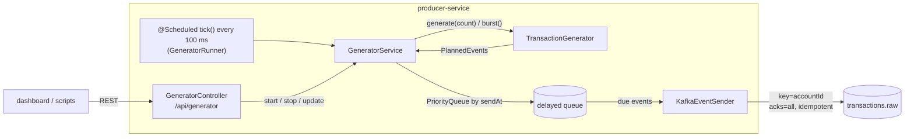

# `producer-service` — transaction generator

[← Back to docs index](README.md)

A Spring Boot 4.1 application that **generates synthetic banking transactions and publishes them to `transactions.raw`**. It injects irregularities on purpose (late delivery, swapped order, duplicates, very large amounts, per-account bursts) so the analytics pipeline has something to detect. A REST API controls it at runtime, and it reports ground-truth counters so the system tests and the dashboard can compare what was *injected* with what the stream *detected*.

| | |
|---|---|
| Port | `8081` (`PRODUCER_PORT`) |
| Main class | `com.bank.txn.producer.ProducerApplication` |
| Writes to | `transactions.raw` (key = `accountId`, value = `TransactionEvent` JSON) |
| Reads from | nothing |
| REST | `GET /api/generator`, `POST /api/generator/start`, `POST /api/generator/stop`, `PUT /api/generator/settings` |
| Actuator | `/actuator/health` (with readiness/liveness probes), `/actuator/info`, `/actuator/metrics` |
| Depends on | [`txn-common`](txn-common.md) |

## How it works



1. On `ApplicationReadyEvent`, `GeneratorRunner` starts the generator if `generator-autostart` is true.
2. Every 100 ms (`GeneratorService.TICK_MS`), `GeneratorService.tick()`:
   - works out how many events this tick needs for `ratePerSecond`. The fractional remainder is carried to the next tick, so 37/s really gives 37/s.
   - asks `TransactionGenerator` for that many `PlannedEvent`s. Each one has the event, the wall-clock time it should be **sent** (`sendAt`), and the kind of `Injection`.
   - may add a burst (probability `burstChancePerSecond × 0.1` per tick).
   - puts everything in a priority queue ordered by `sendAt`, then by generation order.
   - sends every queued event whose `sendAt` ≤ now. Delayed events are still delivered after the generator is stopped.
3. `KafkaEventSender` sends each event to `transactions.raw` with key `accountId`. The completion callback increments `acked` or `errors`.

### Injected irregularities

| Injection | How it is produced | What the stream should see |
|---|---|---|
| `LATE` | `eventTime` = now, but `sendAt` = now + random 5 s … `maxLatenessSeconds` | `LATE_ACCEPTED` or `LATE_DROPPED` (depends on the delay vs. window + grace); also often *out of order*, because newer events of the account arrive first |
| `OUT_OF_ORDER` | two events of one account: seq *n+1* sent now, seq *n* sent 500 ms later | an out-of-order event (and a gap when *n+1* arrives) |
| `DUPLICATE` | the same event (same `eventId`) sent again 100–2000 ms later | a duplicate, dropped by `DedupeProcessor` |
| `HIGH_VALUE` | amount between 200,000 and 1,500,000 INR (25 % decline chance) | a `HIGH_VALUE` alert (threshold 100,000 INR) |
| `BURST` | one account sends `burstSize` events 250 ms apart | a `VELOCITY` alert when more than 10 land in one 1-minute window |

---

## Folder layout

```
producer-service/
├── Dockerfile
├── pom.xml
└── src/
    ├── main/java/com/bank/txn/producer/
    │   ├── ProducerApplication.java
    │   ├── GeneratorConfig.java            (+ nested GeneratorRunner)
    │   ├── api/        GeneratorController, GeneratorStatus
    │   ├── generator/  EventSender, GeneratorService, GeneratorSettings, GeneratorStats,
    │   │               Injection, PlannedEvent, TransactionGenerator
    │   └── kafka/      KafkaEventSender
    ├── main/resources/application.yml
    └── test/java/com/bank/txn/producer/
        ├── GeneratorControllerTest.java
        ├── ProducerKafkaIT.java
        └── generator/  GeneratorServiceTest, TransactionGeneratorTest
```

---

## Build and container files

### [`pom.xml`](../producer-service/pom.xml)

- Parent: `com.bank.txn:txn-analytics:1.0.0` (root pom → Spring Boot 4.1.2 parent).
- Dependencies: `txn-common`, `spring-boot-starter-webmvc`, `spring-boot-starter-kafka`, `spring-boot-starter-validation` (for `@Valid` on settings), `spring-boot-starter-actuator`.
- Test: `spring-boot-starter-test`, `spring-boot-starter-webmvc-test`, `spring-boot-testcontainers`, `testcontainers-kafka`, `testcontainers-junit-jupiter`.
- Build: `finalName` `producer-service` (so the jar is `target/producer-service.jar`), `spring-boot-maven-plugin`, and `maven-failsafe-plugin` bound to `integration-test` + `verify` (runs `*IT` classes during `./mvnw verify`).

### [`Dockerfile`](../producer-service/Dockerfile)

A multi-stage build. The **build context is the repository root**, because it needs the parent pom and `txn-common`.

1. **build** stage (`eclipse-temurin:21-jdk`): copies `mvnw`, `.mvn`, the root pom and all three module poms. Runs `./mvnw -pl producer-service -am dependency:go-offline` with a BuildKit cache mount on `/root/.m2` (failures ignored, `|| true`). Then copies the `txn-common` and `producer-service` sources and runs `package -DskipTests`.
2. **runtime** stage (`eclipse-temurin:21-jre`): creates a system user `app`, plus a `/var/lib/streams` directory the producer never uses (the Dockerfile is a copy of analytics-service's). It copies the jar to `/app/app.jar`, runs as `app`, exposes 8081, and sets `JAVA_OPTS="-XX:MaxRAMPercentage=75 -XX:+ExitOnOutOfMemoryError"` (compose overrides this).
3. `HEALTHCHECK` every 10 s: opens a raw TCP connection with bash `/dev/tcp`, sends `GET /actuator/health/readiness`, and expects `UP`. No curl is needed in the image.
4. `ENTRYPOINT sh -c "exec java $JAVA_OPTS -jar /app/app.jar"`.

### [`application.yml`](../producer-service/src/main/resources/application.yml)

| Key | Value | Notes |
|---|---|---|
| `server.port` | `${PRODUCER_PORT:8081}` | |
| `spring.kafka.bootstrap-servers` | `${KAFKA_BOOTSTRAP:localhost:19092,localhost:29092,localhost:39092}` | compose sets `kafka-1:9092,…` |
| `spring.kafka.producer.key-serializer` | `StringSerializer` | key = accountId |
| `spring.kafka.producer.value-serializer` | `com.bank.txn.common.serde.TransactionEventSerializer` | JSON |
| `spring.kafka.producer.acks` | `all` | the leader waits for all in-sync replicas (with `min.insync.replicas=2`, at least 2 copies) |
| `spring.kafka.producer.compression-type` | `lz4` | |
| `…properties.enable.idempotence` | `true` | no duplicates or reordering caused by retries |
| `…max.in.flight.requests.per.connection` | `5` | the maximum that still keeps idempotent ordering |
| `…linger.ms` | `5` | small batching delay |
| `…delivery.timeout.ms` | `120000` | retries for up to 2 min (rides out broker failover) |
| `…request.timeout.ms` | `15000` | |
| `generator-autostart` | `${GENERATOR_AUTOSTART:true}` | read by `GeneratorConfig` |
| `generator.*` | rate `${GENERATOR_RATE:50}`, accounts 5000, late 0.03, max lateness 90 s, out-of-order 0.02, duplicate 0.01, high-value 0.005, burst chance 0.05/s, burst size 12 | bound to `GeneratorSettings` |
| `management.endpoints.web.exposure.include` | `health,info,metrics` | |
| `management.endpoint.health.probes.enabled` | `true` | enables `/actuator/health/readiness`, used by the Docker health check |

---

## Package `com.bank.txn.producer`

### [`ProducerApplication.java`](../producer-service/src/main/java/com/bank/txn/producer/ProducerApplication.java)

The Spring Boot entry point.
- `@SpringBootApplication`: component scan and auto-configuration (including `KafkaTemplate`).
- `@ConfigurationPropertiesScan`: finds `GeneratorSettings` (`@ConfigurationProperties("generator")`) and binds it from YAML.
- `@EnableScheduling`: turns on `@Scheduled` for `GeneratorRunner.tick()`.
- **`main(String[] args)`**: `SpringApplication.run(ProducerApplication.class, args)`.

### [`GeneratorConfig.java`](../producer-service/src/main/java/com/bank/txn/producer/GeneratorConfig.java)

`@Configuration` that wires the generator from plain (non-Spring) classes.

| Member | What it does |
|---|---|
| **`generatorService(KafkaTemplate<String,TransactionEvent> template, GeneratorSettings settings)`** `@Bean` | Creates one shared `java.util.Random`. Builds a `TransactionGenerator(random, sequenceBase)` with `sequenceBase = (epochSeconds) × 1,000,000`, so sequence numbers after a restart are always higher than before it and the stream does not report false out-of-order events. Wraps the template in a `KafkaEventSender`, uses `Clock.systemUTC()` and the YAML-bound `settings` as the initial settings. |
| **`generatorRunner(GeneratorService service, @Value("${generator-autostart:true}") boolean autostart)`** `@Bean` | Creates the `GeneratorRunner` below. |
| **`static class GeneratorRunner`** | Holds the service and the autostart flag. |
| `GeneratorRunner.onReady()` | `@EventListener(ApplicationReadyEvent.class)`: calls `service.start()` if autostart is true. |
| `GeneratorRunner.tick()` | `@Scheduled(fixedRate = GeneratorService.TICK_MS)` (100 ms): calls `service.tick()`. This is the heartbeat of the generator. |

---

## Package `com.bank.txn.producer.api`

### [`GeneratorController.java`](../producer-service/src/main/java/com/bank/txn/producer/api/GeneratorController.java)

`@RestController @RequestMapping("/api/generator")` controls the generator at runtime. The dashboard's `GeneratorControls` panel and the system test scripts call it (through nginx at `/api/generator`).

| Method | HTTP | Input | Output | Behaviour |
|---|---|---|---|---|
| `status()` | `GET /api/generator` | – | `GeneratorStatus` | `new GeneratorStatus(service.isRunning(), service.settings(), service.stats())` |
| `start()` | `POST /api/generator/start` | – | `GeneratorStatus` | `service.start()` (no-op if already running), then `status()` |
| `stop()` | `POST /api/generator/stop` | – | `GeneratorStatus` | `service.stop()`; events already queued are still delivered |
| `update(GeneratorSettings)` | `PUT /api/generator/settings` | JSON body, `@Valid` | `GeneratorStatus` | Replaces **all** settings atomically. Constraint violations return **400** and the service is not called. |

Example response:

```json
{"running":true,
 "settings":{"ratePerSecond":50,"accounts":5000,"lateRatio":0.03,"maxLatenessSeconds":90,"outOfOrderRatio":0.02,
             "duplicateRatio":0.01,"highValueRatio":0.005,"burstChancePerSecond":0.05,"burstSize":12},
 "stats":{"generated":1000,"sent":1010,"acked":1010,"sendErrors":0,"pending":3,"injectedLate":30,
          "injectedOutOfOrder":20,"injectedDuplicates":10,"injectedHighValue":5,"injectedBurstEvents":12}}
```

### [`GeneratorStatus.java`](../producer-service/src/main/java/com/bank/txn/producer/api/GeneratorStatus.java)

`public record GeneratorStatus(boolean running, GeneratorSettings settings, GeneratorStats stats)`: the response body of every generator endpoint. Mirrored by the `GeneratorStatus` TypeScript interface in the dashboard.

---

## Package `com.bank.txn.producer.generator`

### [`EventSender.java`](../producer-service/src/main/java/com/bank/txn/producer/generator/EventSender.java)

`public interface EventSender { CompletableFuture<?> send(TransactionEvent event); }`. An abstraction over the Kafka producer, so `GeneratorService` can be unit tested with a lambda (see `GeneratorServiceTest`). The future completes normally on broker ack, or exceptionally on failure.

### [`GeneratorSettings.java`](../producer-service/src/main/java/com/bank/txn/producer/generator/GeneratorSettings.java)

`@ConfigurationProperties("generator") public record GeneratorSettings(...)`. The initial values come from `application.yml`; `PUT /api/generator/settings` replaces them. Bean Validation limits:

| Component | Type | Limits | Default (`defaults()` and YAML) | Meaning |
|---|---|---|---|---|
| `ratePerSecond` | int | 0–5000 | 50 | target events/s, not counting injected duplicates |
| `accounts` | int | 1–1,000,000 | 5000 | number of simulated accounts (`ACC-000000` …) |
| `lateRatio` | double | 0–0.5 | 0.03 | share of events delivered late |
| `maxLatenessSeconds` | int | 6–600 | 90 | maximum delivery delay of late events |
| `outOfOrderRatio` | double | 0–0.5 | 0.02 | share of draws that become a swapped pair |
| `duplicateRatio` | double | 0–0.5 | 0.01 | share of events sent twice |
| `highValueRatio` | double | 0–0.5 | 0.005 | share of very large amounts |
| `burstChancePerSecond` | double | 0–1 | 0.05 | probability per second that one account fires a burst |
| `burstSize` | int | 2–100 | 12 | transactions per burst |

- **`MIN_LATENESS_SECONDS = 5`**: the minimum delay of a late event.
- **`static defaults()`**: returns the defaults above. Used by tests.

The dashboard sliders allow less than the validation does: rate up to 2000, late/out-of-order/duplicate ratios up to 0.2, high-value up to 0.05.

### [`GeneratorStats.java`](../producer-service/src/main/java/com/bank/txn/producer/generator/GeneratorStats.java)

`public record GeneratorStats(...)`: ground-truth counters since startup.

| Field | Meaning |
|---|---|
| `generated` | logical transactions created (duplicates excluded; a swapped pair counts as 2) |
| `sent` | records handed to the sender (= generated + duplicates once the queue is empty) |
| `acked` | sends the broker acknowledged |
| `sendErrors` | failed or rejected sends |
| `pending` | events still waiting in the delay queue |
| `injectedLate` / `injectedOutOfOrder` / `injectedDuplicates` / `injectedHighValue` / `injectedBurstEvents` | counts per `Injection` kind. For out-of-order, one per swapped pair. |

### [`Injection.java`](../producer-service/src/main/java/com/bank/txn/producer/generator/Injection.java)

`public enum Injection { NONE, LATE, OUT_OF_ORDER, DUPLICATE, HIGH_VALUE, BURST }`: which irregularity, if any, a planned event carries. It is used only for counting (`GeneratorService.plan`); it is not sent to Kafka.

### [`PlannedEvent.java`](../producer-service/src/main/java/com/bank/txn/producer/generator/PlannedEvent.java)

`public record PlannedEvent(TransactionEvent event, Instant sendAt, Injection injection)`: an event plus the wall-clock instant it should be sent. `sendAt` is later than now for late, swapped and duplicate copies.

### [`TransactionGenerator.java`](../producer-service/src/main/java/com/bank/txn/producer/generator/TransactionGenerator.java)

A pure, Kafka-free generator of realistic transactions. It keeps per-account sequence counters in a `ConcurrentHashMap<String, Long>`.

| Member | Description |
|---|---|
| `HIGH_VALUE_MIN_INR = 200000` | lower bound of high-value amounts |
| `MERCHANT_CATEGORIES` | `GROCERY, FUEL, TRAVEL, DINING, ELECTRONICS, UTILITIES, HEALTHCARE, ENTERTAINMENT, RETAIL` |
| **`TransactionGenerator(RandomGenerator random)`** | test constructor; sequences start at 1 (`sequenceBase = 0`) |
| **`TransactionGenerator(RandomGenerator random, long sequenceBase)`** | each account's first sequence number is `sequenceBase + 1` |
| **`generate(int count, Instant now, GeneratorSettings s)`** → `List<PlannedEvent>` | For each of `count` draws: picks a random account, draws `r ∈ [0,1)` and walks the ratio bands in order: **late** (`r < lateRatio`) → one event with `sendAt = now + random(5 s, maxLateness)`, tagged `LATE`. **Out-of-order** → creates *first* (seq n, eventTime now) and *second* (seq n+1, eventTime now+200 ms); emits *second* at `now` (`NONE`) and *first* at `now+500 ms` (`OUT_OF_ORDER`). **Duplicate** → the event at `now` (`NONE`) and the identical event at `now + 100–2000 ms` (`DUPLICATE`). **High value** → one event with a high amount (`HIGH_VALUE`). **Otherwise** a normal event (`NONE`). The returned list can be longer than `count`. |
| **`burst(Instant now, GeneratorSettings s)`** → `List<PlannedEvent>` | One random account; `burstSize` events with eventTime and sendAt at `now + i×250 ms`, all tagged `BURST`. |
| `static accountId(int index)` | formats `ACC-%06d` |
| `newEvent(String accountId, Instant eventTime, boolean highValue)` | Builds one `TransactionEvent`: next sequence number (`sequences.merge`); **type** weighted 20 % DEPOSIT / 25 % WITHDRAWAL / 20 % TRANSFER / 35 % PAYMENT; **channel** weighted by type (e.g. WITHDRAWAL 85 % ATM / 15 % BRANCH; PAYMENT 50 % POS / 25 % ONLINE / 25 % MOBILE); **currency** 85 % INR / 7 % USD / 5 % EUR / 3 % GBP; **amount**: an INR amount (high value 200k–1.5M, otherwise `typicalAmountInr`) divided by the currency rate, scale 2, minimum 1.00; **status** DECLINED with 25 % chance for high value, otherwise 3 %; **region** from `floorMod(accountId.hashCode(), 4)`; **merchantCategory** random for PAYMENT, otherwise null; `producedAt` null (set at send time). |
| `typicalAmountInr(TransactionType)` (private) | Log-normal-ish: `median × exp(N(0,1) × 0.9)`, clamped to 10…150,000 INR. Medians: DEPOSIT 15,000, WITHDRAWAL 4,000, TRANSFER 12,000, PAYMENT 1,500. |
| `randomAmount(min, max)` (private) | uniform `BigDecimal`, scale 2 |
| `randomBetween(min, max)` (private) | uniform `long` |
| `pick(T[] values, double... weights)` (private) | weighted random choice; falls back to the last value |

### [`GeneratorService.java`](../producer-service/src/main/java/com/bank/txn/producer/generator/GeneratorService.java)

Runs the generator: rate control, the delay queue, sending, and counters.

| Member | Description |
|---|---|
| `TICK_MS = 100` | scheduler period |
| state | `AtomicReference<GeneratorSettings> settings`, `AtomicBoolean running`, `PriorityQueue<Queued> queue` ordered by `(sendAt, order)`, `long order`, `double carry`, `AtomicLong`s `generated/sent/acked/errors`, `EnumMap<Injection, AtomicLong> injected` |
| `private record Queued(PlannedEvent planned, long order)` | queue entry. `order` keeps FIFO order for events due at the same instant, which preserves per-account sequence order (tested by `eventsDueAtTheSameTimeKeepGenerationOrder`). |
| **constructor** `(TransactionGenerator, EventSender, Clock, RandomGenerator, GeneratorSettings initial)` | stores the collaborators and sets every injection counter to 0 |
| **`start()`** | CAS `running` false→true and logs the settings |
| **`stop()`** | CAS true→false; queued delayed events are still delivered |
| **`isRunning()`** | current flag |
| **`settings()`** | current settings |
| **`update(GeneratorSettings)`** | atomically replaces the settings (takes effect next tick) |
| **`tick()`** | Reads `now` and the current settings. Inside `synchronized(queue)`: if running, `want = rate × 0.1 + carry`, `count = (int) want`, `carry = want − count`, then `plan(generator.generate(count, now, s))`. A burst is planned with probability `burstChancePerSecond × 0.1`. Then, **always**, it polls and `send`s every entry with `sendAt ≤ now`. |
| `plan(List<PlannedEvent>)` (private) | for each event: `generated++` unless it is a `DUPLICATE`, `injected[kind]++`, then adds it to the queue with the next `order` |
| `send(PlannedEvent)` (private) | `sent++`, then `sender.send(event.withProducedAt(now))`. The completion callback does `acked++`, or `errors++` with a warning log. A synchronous `RuntimeException` from the sender also counts as an error. |
| **`stats()`** | builds a `GeneratorStats` (reads the queue size under its lock) |

---

## Package `com.bank.txn.producer.kafka`

### [`KafkaEventSender.java`](../producer-service/src/main/java/com/bank/txn/producer/kafka/KafkaEventSender.java)

`public class KafkaEventSender implements EventSender`: the only class that talks to Kafka.

- **Constructor** `KafkaEventSender(KafkaTemplate<String, TransactionEvent> template)`.
- **`send(TransactionEvent event)`**: `template.send(Topics.TRANSACTIONS_RAW, event.accountId(), event)`. Using the account id as key makes the default partitioner put an account's events in one partition, which keeps them in order.

---

## Tests

| Class | Type | What it covers |
|---|---|---|
| [`TransactionGeneratorTest`](../producer-service/src/test/java/com/bank/txn/producer/generator/TransactionGeneratorTest.java) | unit (seeded `Random(42)`) | per-account sequences go 1,2,3… in generation order; normal events are valid (UUID id, `ACC-\d{6}`, positive, scale 2, < 160k INR, `sendAt = eventTime = now`); injection ratios within statistical tolerance over 40k draws; late events keep `eventTime = now` and `sendAt ∈ [now+5 s, now+90 s]`; swapped pair delivers seq n+1 first; duplicates share an `eventId` and come later; high-value ≥ 199k INR; a burst is one account with consecutive sequences; `sequenceBase` 5,000,000 → first seq 5,000,001 |
| [`GeneratorServiceTest`](../producer-service/src/test/java/com/bank/txn/producer/generator/GeneratorServiceTest.java) | unit, with a `MutableClock` and an in-memory `EventSender` | fractional rate (37/s × 10 s ≈ 370); nothing sent when stopped; late events held back, then delivered after stop with `producedAt > eventTime + 4 s`; stats arithmetic (`generated = 5000 + swappedPairs`, `sent = generated + duplicates`); failed futures counted as `sendErrors`; events due at the same time keep per-account order |
| [`GeneratorControllerTest`](../producer-service/src/test/java/com/bank/txn/producer/GeneratorControllerTest.java) | `@WebMvcTest` with `@MockitoBean GeneratorService` | `GET` returns status JSON; start/stop call the service; invalid settings (rate 99999, lateRatio 0.9) → 400 and no update; valid settings → `update(...)` with the exact record |
| [`ProducerKafkaIT`](../producer-service/src/test/java/com/bank/txn/producer/ProducerKafkaIT.java) | Testcontainers (`apache/kafka:4.4.0`), `@ServiceConnection` | creates `transactions.raw` (6 partitions); checks the producer config has `acks=all` and `enable.idempotence=true`; starts the generator (200/s, 50 accounts, no irregularities) and consumes ≥ 400 records: key == `accountId`, `producedAt` set, one partition per account, sequences increase per account, and more than one partition is used |

### Test methods

**`TransactionGeneratorTest`**: field `generator = new TransactionGenerator(new Random(42))`; helper `settings(late, ooo, dup, high)` builds `GeneratorSettings(100, 50, …, 90, …, 0, 12)`.

| Method | Asserts |
|---|---|
| `sequenceNumbersIncreaseByOnePerAccountInGenerationOrder` | 5000 events: each account's sequences are exactly 1, 2, 3, … |
| `regularEventsAreValid` | 2000 normal events: `sendAt == eventTime == NOW`, valid id/account/amount |
| `injectionRatiosMatchSettings` | 40,000 draws: LATE ≈ 5 %, OUT_OF_ORDER ≈ 3 %, DUPLICATE ≈ 2 %, HIGH_VALUE ≈ 1 % |
| `lateEventsKeepEventTimeButAreDeliveredFiveToMaxSecondsLater` | `eventTime == NOW`, `sendAt ∈ [NOW+5 s, NOW+90 s]` |
| `outOfOrderPairDeliversHigherSequenceFirst` | 2 events, same account; the first planned has seq + 1 and an earlier `sendAt`; the second is tagged `OUT_OF_ORDER` |
| `duplicatesShareEventId` | the second event equals the first, is tagged `DUPLICATE`, and is sent later |
| `highValueEventsExceedThreshold` | every event ≥ 199,000 INR |
| `burstIsOneAccountWithConsecutiveSequences` | 12 events, one account, consecutive sequences |
| `sequenceBaseKeepsSequencesIncreasingAcrossRestarts` | base 5,000,000 → first sequence 5,000,001 |

**`GeneratorServiceTest`**: nested `MutableClock extends Clock` (`getZone`, `withZone`, `instant`, `advanceMs(ms)`); field `sender` collects events into `sent`; helpers `service(settings)` (seeded `Random(7)`) and `runSeconds(svc, n)` (10 ticks per second, advancing the clock 100 ms per tick).

| Method | Asserts |
|---|---|
| `sendsConfiguredRateIncludingFractionalRates` | 37/s for 10 s → 369–371 sent, all acked |
| `doesNothingWhenStopped` | never started → nothing sent |
| `lateEventsAreHeldBackAndStillDeliveredAfterStop` | 100 % late, 1 s then stop: 0 sent, 100 pending; after 21 s all 100 sent with `producedAt > eventTime + 4 s` |
| `statsCountInjections` | `generated == 5000 + injectedOutOfOrder`, `sent == generated + injectedDuplicates`, `pending == 0`, late within 400–600 |
| `sendFailuresAreCounted` | a sender returning failed futures → `sendErrors == 10` |
| `eventsDueAtTheSameTimeKeepGenerationOrder` | 2000/s over 3 accounts: each account's sequences arrive as `prev + 1` |

**`GeneratorControllerTest`** (`@WebMvcTest(GeneratorController.class)`, `MockMvc mvc`, `@MockitoBean GeneratorService service`):

| Method | Asserts |
|---|---|
| `returnsStatus` | `GET /api/generator` → 200 with `$.running`, `$.settings.ratePerSecond`, `$.stats.generated` |
| `startAndStop` | `POST …/start` and `…/stop` → 200; `service.start()` / `stop()` called |
| `rejectsInvalidSettings` | out-of-range body → 400; `update` never called |
| `updatesValidSettings` | valid body → 200; `update(new GeneratorSettings(500, 10, 0.1, 90, 0, 0, 0, 0, 12))` |

**`ProducerKafkaIT`** (static `KafkaContainer kafka`; autowired `GeneratorService generator` and `ProducerFactory producerFactory`):

| Method | Asserts |
|---|---|
| `createTopic` (`@BeforeAll`) | creates `transactions.raw` with 6 partitions, RF 1, using `AdminClient` |
| `producerIsIdempotentWithAcksAll` | the producer factory config has `acks=all` and `enable.idempotence=true` |
| `eventsAreKeyedByAccountAndOrderedPerAccount` | starts the generator and consumes ≥ 400 records within 20 s; checks keys, `producedAt`, per-account partition stability, increasing sequences, and more than one partition used |
